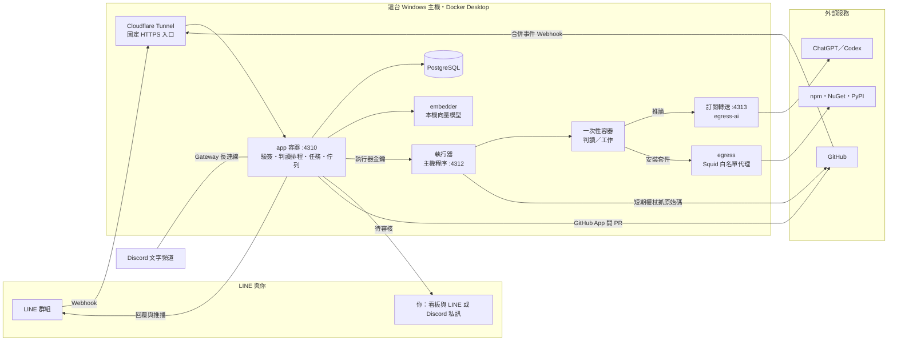
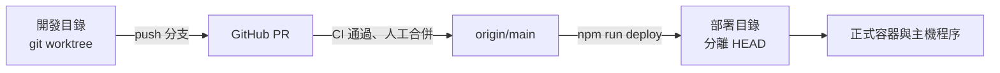

# chat2pr

在 LINE 群組裡提需求，AI 整理成任務，交給隔離容器裡的 Codex 改程式或調查問題；通過測試與獨立審查後才開 GitHub PR，由人決定是否合併。

（程式內部的容器、資料卷與排程工作使用 `line-agentflow`／`LINE-AgentFlow` 作為固定識別名稱。）

> 給 AI 代理與部署者：要部署請照 [部署手冊](docs/deployment.md) 由上而下執行；在這個儲存庫工作前請先讀 [專案慣例與注意事項](docs/conventions.md)。機密一律由人在本機設定頁輸入，不要貼進對話，也不要讀出 `.env`、`.local/`、`.codex-service/` 的內容。

## 解決什麼問題

小團隊的需求多半散落在 LINE 群組：「首頁按鈕改綠色」「工單匯入失敗的那張是哪一張？」「這個欄位是誰在寫？」。開發者要把聊天整理成工作、找出是哪個專案、切換環境、改完再回報，大量時間花在轉述與等待。

chat2pr 把這段流程自動化，同時保留人的決定權：

| 痛點                                   | 這個專案的做法                                                                                                                      |
| -------------------------------------- | ----------------------------------------------------------------------------------------------------------------------------------- |
| 需求散在聊天裡，容易漏掉或被誤解       | 機器人收下群組訊息與圖片，AI 整理成有驗收條件的任務；必要資訊不足時只問一件事；有合理預設就列出假設，產品方向不同時才提供推薦方案。 |
| 一個群組對應多個儲存庫，不知道要改哪個 | 依群組綁定、訊息指名與實際檔案證據判斷目標專案；判斷不了就交給人確認，不硬猜。                                                      |
| 只是想問程式怎麼運作，也要等工程師有空 | **查詢任務**：AI 在隔離容器讀程式碼回答，附檔案路徑與行號，不開 PR；明確指名專案時可自動執行。                                      |
| 讓 AI 直接改程式不放心                 | 修改一律先經人確認；在用完即丟的容器裡開發，必須通過測試與獨立審查才建立 PR；合併由人在 GitHub 執行，**絕不自動部署目標專案**。     |
| AI 拿得到太多權限                      | 工作容器非 root、唯讀根目錄、沒有 Docker socket、拿不到 GitHub 寫入憑證或 LINE 機密；網路依階段限制。                               |

## 一則訊息會經過哪些地方

以「`/任務 把首頁的訂購按鈕改成綠色`」為例。「這台 Windows 主機」框內的元件都在同一台主機上，對外只有一個固定 HTTPS 入口；主機不用開放任何對外連接埠。



| 步驟                      | 發生在哪裡                                   | 做什麼                                                                                                             |
| ------------------------- | -------------------------------------------- | ------------------------------------------------------------------------------------------------------------------ |
| 1. 收到訊息               | LINE Webhook、Discord Gateway               | LINE 透過公開入口送出群組訊息；Discord 由 app 對外連線，接收文字頻道訊息。                                                                    |
| 2. 驗簽、存檔、回「收到」 | app、PostgreSQL                              | 驗證 LINE 簽章，再把兩個平台的來源訊息存檔，圖片背景下載。LINE 用回覆權杖確認收訊，Discord 依頻道設定在原訊息加上反應。 |
| 3. 等群組安靜             | app                                          | 安靜 60 秒（最多累積 5 分鐘；引用機器人回答的追問只等 5 秒），把碎片訊息合在一起。                                 |
| 4. 找回上下文             | app、embedder、PostgreSQL                    | 本機向量模型檢索近期對話、群組記憶、過去同專案的任務，資料不送到外部。                                             |
| 5. AI 判讀                | 執行器 → 一次性判讀容器 → 訂閱轉送 → ChatGPT | 判斷修改或查詢、目標專案、風險，寫出驗收條件；缺資訊只問一件事。容器裡沒有 ChatGPT 登入檔。                        |
| 6. 等你確認               | 看板收件匣、LINE 或 Discord 私訊             | 修改一律要你按「確認專案並核准修改」。明確指名專案的查詢可自動開始。                                               |
| 7. 排隊、建立工作容器     | app 佇列（pg-boss）→ 執行器                  | 同時執行預設 2 件、每件最長 30 分鐘。容器非 root、根目錄唯讀、沒有 Docker socket。                                 |
| 8. 準備原始碼             | 執行器 → GitHub                              | 用短期權杖抓確認過的 commit，同版本用本機快取。                                                                    |
| 9. 安裝相依套件           | 工作容器 → egress → 套件來源                 | 只能經白名單代理下載。審查放行的系統套件存成專案衍生映像；測試要 SQL Server 時改用內含 SQL Server 的映像。         |
| 10. Codex 修改程式        | 工作容器 → 訂閱轉送 → ChatGPT                | Codex 讀程式、改程式。查詢在這一步寫調查報告，之後直接跳到第 13 步。                                               |
| 11. 收集差異、跑測試      | 工作容器（沒有網路）                         | 以可信的原始基底算出變更；測試寫死 LocalDB 時自動導向容器內的 SQL Server。                                         |
| 12. 獨立審查              | 另一個唯讀的 Codex                           | 檢查是否符合需求、測試是否可信；不通過自動修復一次，仍失敗就停下交給你。                                           |
| 13. 開 PR、回報           | app → GitHub、LINE                           | GitHub App 建立分支、Issue、PR；私訊你並在群組回報。推播算每月額度，用完時群組成員打 `/進度` 免費取回。            |
| 14. 由你合併              | GitHub → Webhook → app                       | 你在 GitHub 合併；看板標成已合併。系統不會自動部署目標專案。                                                       |

看板「系統」頁的「系統架構」有同一套步驟的互動圖，可以逐步播放。

## 元件一覽

| 元件                          | 在哪裡跑                                    | 做什麼                                                                 | 拿不到什麼                                                |
| ----------------------------- | ------------------------------------------- | ---------------------------------------------------------------------- | --------------------------------------------------------- |
| app                           | Docker 容器，`127.0.0.1:4310`               | Webhook、看板與 API、判讀排程、任務佇列（pg-boss）、LINE 與 GitHub App | 不直接執行專案程式                                        |
| db                            | Docker 容器                                 | PostgreSQL：訊息（依設定保留，預設 30 天）、任務、稽核                 | 只對 app 開放                                             |
| embedder                      | Docker 容器                                 | 本機向量模型，供 RAG 檢索                                              | 沒有外網                                                  |
| 執行器                        | Windows 主機程序 `127.0.0.1:4312`           | 建立與清理判讀、工作、定期檢查容器                                     | 只接受帶執行器金鑰的請求                                  |
| 判讀／工作容器                | 一次性 Docker 容器                          | 判讀、安裝、Codex 開發、測試、獨立審查                                 | ChatGPT 登入檔、GitHub 寫入憑證、LINE 機密、Docker socket |
| subscription-relay、egress-ai | Docker 容器                                 | 把容器的推論轉送到 ChatGPT，容器本身不持有登入檔                       | 只轉送推論，不開放其他目的地                              |
| egress                        | Docker 容器（Squid）                        | 安裝階段的下載代理，只放行白名單網域                                   | 私有網路與主機                                            |
| 固定 HTTPS 入口               | Cloudflare Tunnel、ngrok 或自備程序         | 唯一的對外入口，轉到 `127.0.0.1:4310`                                  | —                                                         |
| 監督程序                      | Windows 排程工作 `LINE-AgentFlow`（無視窗） | 每 30 秒檢查 Docker、容器、執行器與通道，停了就拉起來                  | —                                                         |

網路、資料卷、隔離方式與工作映像的細節見 [架構](docs/architecture.md)。

## 功能

- **LINE 收件**：群組文字與圖片、`/任務` 指令或自動辨識、引用回覆指定圖片、撤回同步清除。補問附常見答案按鈕，成員點按鈕或「回覆」就能作答；`/進度` 用 reply token 取回進度與沒送到的回覆，不耗推播額度。
- **需求判讀**：彙整零碎對話、合併補充、判斷修改或查詢、專案路由、群組記憶、風險規則。
- **隔離執行**：Codex（ChatGPT 訂閱或 OpenAI API）在拋棄式容器裡安裝、開發、測試、獨立審查；AI 自動判斷專案的安裝與測試指令；測試要 SQL Server（含寫死 LocalDB）時自動改用內含 SQL Server 的映像，缺的系統工具經審查後裝成專案衍生映像。
- **查詢報告**：唯讀調查並附依據，可一次比對多個專案；回答直接回到看板、GitHub Issue 與 LINE。
- **看板**：收件匣、任務詳情與執行紀錄、唯讀聊天室（含機器人訊息與送達狀態，沒送到的可複製）、群組與專案管理、成員權限（GitHub 登入）；危險設定變更先確認並寫進稽核。
- **本機 RAG（選用）**：本機向量模型索引舊對話、任務與專案檔案，判讀時找回上下文。
- **定期檢查**：例如每小時檢查機台連線；核准後依排程執行 SQL／HTTP／TCP 探測，不用 AI 額度，狀態改變才通知，異常時可自動請 AI 調查原因。
- **維運**：一鍵部署與冒煙測試、每日加密備份、Docker 定期清理、開機自動恢復（監督程序無視窗執行）、自備通道看門狗、LINE 推播額度用完時自動暫停與恢復後續送、外部健康監控。

## 系統需求

| 項目     | 需求                                                                                                                  |
| -------- | --------------------------------------------------------------------------------------------------------------------- |
| 主機     | Windows 11 + Docker Desktop（Linux 容器）。這是目前唯一驗證過的組合，Linux 主機尚不支援。                             |
| 軟體     | Node.js 24、Git、Docker Compose v2                                                                                    |
| 硬體     | 建議 16 GB 記憶體、40 GB 可用磁碟                                                                                     |
| 外部帳號 | LINE Messaging API channel、GitHub App、固定 HTTPS 網址（ngrok 或 Cloudflare Tunnel）、ChatGPT 訂閱或 OpenAI API 金鑰 |
| 網路     | 只需要對外連線；不需要開放任何輸入連接埠                                                                              |

## 部署

完整步驟、每一步的預期結果與疑難排解在 [部署手冊](docs/deployment.md)。概要如下（PowerShell，在儲存庫根目錄執行）：

```powershell
# 1. 取得程式碼
git clone https://github.com/<你的帳號>/chat2pr.git
cd chat2pr
npm ci

# 2. 產生本機設定，並指定擁有者（GitHub 數字 ID）
npm run init
Add-Content .env "ADMIN_GITHUB_ID=你的GitHub數字ID"

# 3. 由人在本機設定頁填入 LINE、GitHub App、入口等機密
npm run setup

# 4. 建置工作映像與下載向量模型
docker build -f worker/Dockerfile -t line-agentflow-worker:local .
docker build -f infra/source/Dockerfile -t line-agentflow-source:local .
docker compose --profile init run --rm embedder-init

# 5. 啟動服務、登入 Codex 訂閱、註冊開機自動啟動
docker compose --profile full up -d --build
npm run codex:login
npm run install:startup
Start-ScheduledTask -TaskName 'LINE-AgentFlow'
```

接著設定 LINE Webhook 與 GitHub App 安裝，用看板收件匣的「開始使用」清單完成驗收。新實例預設**全域暫停**，驗收完成前不會自動派工。

擁有者可在看板「設定」的「連線與金鑰」分頁更新 LINE Channel Secret、LINE Channel Access Token、Discord 機器人權杖與應用程式 ID、OpenAI API 金鑰。更新需在 GitHub 登入後十分鐘內操作。看板只顯示設定狀態和最後更新時間。GitHub App／OAuth、工作階段密鑰、公開網址與通道仍在本機設定頁維護。詳見[更新連線金鑰](docs/operations.md#更新連線金鑰)。

### 從 Discord 頻道收需求

1. 從 [Discord 開發者入口](https://discord.com/developers/applications) 建立應用程式，複製一般資訊中的應用程式 ID。到機器人頁產生權杖，並開啟「讀取訊息內容」（Message Content Intent）。
2. 由擁有者在看板「設定」的「連線與金鑰」分頁輸入兩項資料。也可在主機執行 `npm run setup`，從本機設定頁輸入。儲存後 app 會自動重連 Discord。
3. 在應用程式的「安裝」頁設定伺服器安裝與機器人權限，取得安裝連結並邀請機器人。權限與操作詳見 [Discord 連線](docs/operations.md#discord-連線)。
4. 在文字頻道送一則訊息。到看板「群組」篩選 Discord，選擇該頻道、綁定專案並啟用。依需要開啟群組回覆。
5. 用 `/任務` 提出需求，或用 `/進度` 查看本頻道的任務與未送達的回覆。補問可以按常見答案，也可以直接回覆機器人的訊息。

管理者可在「設定」的「通知」分頁找到「管理者通知」，選擇 LINE 或 Discord，產生配對碼後，在選定平台的機器人私訊傳送 `配對 <代碼>`。配對碼 10 分鐘內有效，配對完成後即可儲存通知目的地。

Discord 使用 app 主動建立的對外長連線。LINE 可同時收訊並維持原本的 Webhook。

### 部署流程

一台主機上有兩份程式碼，各有用途：



- **開發目錄**：另外 clone 或 `git worktree`，在這裡改程式、跑測試。不要在這裡執行 `docker compose up`，會動到正式容器。
- **部署目錄**：有 `.local/secrets.json` 的那一份，只用 `npm run deploy` 更新。

`npm run deploy` 依序執行下列步驟，任何一步失敗就停下並說明原因：

1. 確認部署目錄沒有未提交的修改、`.env` 已設定擁有者，也沒有排隊或執行中的任務。
2. 取得 `origin/main` 並切過去（分離 HEAD）；已是最新版本時只執行冒煙測試。
3. 相依套件有變更時執行 `npm ci`。
4. 建置工作映像、原始碼映像與服務容器；資料庫遷移在 `app` 啟動時自動執行。
5. 重啟主機執行器，必要時連同監督程序與通道。
6. 等服務恢復後執行冒煙測試：健康檢查、看板、登入保護、Webhook 簽章、執行器身分、對外入口。

隨時可以用 `npm run smoke` 只跑冒煙測試。多台伺服器、備份還原與搬機見部署手冊。

## 文件

| 文件                                      | 內容                                                       |
| ----------------------------------------- | ---------------------------------------------------------- |
| [使用指南](docs/usage.md)                 | 在 LINE 與看板上怎麼提需求、確認、查詢                     |
| [部署手冊](docs/deployment.md)            | 從零部署、外部帳號設定、升級、備份還原、多台部署、疑難排解 |
| [架構](docs/architecture.md)              | 元件、容器、網路、資料卷、隔離與工作映像                   |
| [維運](docs/operations.md)                | 自動運作的規則、日常處理、已知邊界                         |
| [開發與驗證](docs/development.md)         | 原始碼結構、測試、交付流程、真實服務驗收                   |
| [專案慣例與注意事項](docs/conventions.md) | 一定要一起改的地方、不能在哪裡執行的指令、正常現象         |
| [文件總覽](docs/README.md)                | 全部文件列表                                               |

## 安全

- 所有連接埠只綁在主機回環介面；對外唯一入口是固定 HTTPS 通道。
- 機密存在 `.local/secrets.json`（Windows 權限限制為目前使用者），每日備份以 AES-256-GCM 加密。
- 工作容器拿不到主訂閱登入、GitHub 寫入憑證、LINE 機密、資料庫連線機密或 Docker socket。
- 查詢回答會遮蔽常見憑證格式；要求交出密碼、金鑰實際值的查詢一律等人工確認。

發現安全問題時，請不要開公開 Issue，改用 GitHub 的私下回報（Security → Report a vulnerability）。

## 授權

本專案以 [MIT License](LICENSE) 授權。
