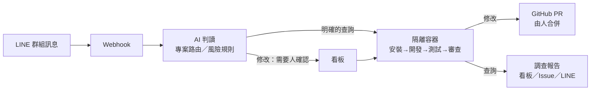
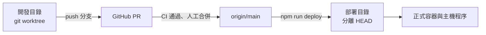

# chat2pr

在 LINE 群組裡提需求，AI 整理成任務，交給隔離容器裡的 Codex 改程式或調查問題；通過測試與獨立審查後才開 GitHub PR，由人決定是否合併。

（程式內部的容器、資料卷與排程工作使用 `line-agentflow`／`LINE-AgentFlow` 作為固定識別名稱。）

> 給 AI 代理與部署者：要部署請照 [部署手冊](docs/deployment.md) 由上而下執行；在這個儲存庫工作前請先讀 [專案慣例與注意事項](docs/conventions.md)。機密一律由人在本機設定頁輸入，不要貼進對話，也不要讀出 `.env`、`.local/`、`.codex-service/` 的內容。

## 解決什麼問題

小團隊的需求多半散落在 LINE 群組：「首頁按鈕改綠色」「工單匯入失敗的那張是哪一張？」「這個欄位是誰在寫？」。開發者要把聊天整理成工作、找出是哪個專案、切換環境、改完再回報，大量時間花在轉述與等待。

chat2pr 把這段流程自動化，同時保留人的決定權：

| 痛點                                   | 這個專案的做法                                                                                                                  |
| -------------------------------------- | ------------------------------------------------------------------------------------------------------------------------------- |
| 需求散在聊天裡，容易漏掉或被誤解       | 機器人收下群組訊息與圖片，AI 整理成有驗收條件的任務；必要資訊不足時只問一件事；有合理預設就列出假設，產品方向不同時才提供推薦方案。                                           |
| 一個群組對應多個儲存庫，不知道要改哪個 | 依群組綁定、訊息指名與實際檔案證據判斷目標專案；判斷不了就交給人確認，不硬猜。                                                  |
| 只是想問程式怎麼運作，也要等工程師有空 | **查詢任務**：AI 在隔離容器讀程式碼回答，附檔案路徑與行號，不開 PR；明確指名專案時可自動執行。                                  |
| 讓 AI 直接改程式不放心                 | 修改一律先經人確認；在用完即丟的容器裡開發，必須通過測試與獨立審查才建立 PR；合併由人在 GitHub 執行，**絕不自動部署目標專案**。 |
| AI 拿得到太多權限                      | 工作容器非 root、唯讀根目錄、沒有 Docker socket、拿不到 GitHub 寫入憑證或 LINE 機密；網路依階段限制。                           |

## 功能

- **LINE 收件**：群組文字與圖片、`/任務` 指令或自動辨識、引用回覆指定圖片、撤回同步清除。
- **需求判讀**：彙整零碎對話、合併補充、判斷修改或查詢、專案路由、群組記憶、風險規則。
- **隔離執行**：Codex（ChatGPT 訂閱或 OpenAI API）在拋棄式容器裡安裝、開發、測試、獨立審查；AI 自動判斷專案的安裝與測試指令。
- **查詢報告**：唯讀調查並附依據，可一次比對多個專案；回答直接回到看板、GitHub Issue 與 LINE。
- **看板**：收件匣、任務詳情與執行紀錄、唯讀聊天室、群組與專案管理、成員權限（GitHub 登入）。
- **本機 RAG（選用）**：本機向量模型索引舊對話、任務與專案檔案，判讀時找回上下文。
- **維運**：一鍵部署與冒煙測試、每日加密備份、Docker 定期清理、開機自動恢復、外部健康監控。

## 運作流程



元件、網路、資料卷與隔離方式見 [架構](docs/architecture.md)。

## 系統需求

| 項目     | 需求                                                                                                                  |
| -------- | --------------------------------------------------------------------------------------------------------------------- |
| 主機     | Windows 11 + Docker Desktop（Linux 容器）。這是目前唯一驗證過的組合，Linux 主機尚不支援。                             |
| 軟體     | Node.js 24、Git、Docker Compose v2                                                                                    |
| 硬體     | 建議 16 GB 記憶體、40 GB 可用磁碟                                                                                     |
| 外部帳號 | LINE Messaging API channel、GitHub App、固定 HTTPS 網址（ngrok 或 Cloudflare Tunnel）、ChatGPT 訂閱或 OpenAI API 金鑰 |
| 網路     | 只需要對外連線；不需要開放任何輸入連接埠                                                                              |

## 部署

完整步驟、每一步的預期結果與疑難排解在 [部署手冊](docs/deployment.md)。概要如下（PowerShell，在儲存庫根目錄執行）：

```powershell
# 1. 取得程式碼
git clone https://github.com/<你的帳號>/chat2pr.git
cd chat2pr
npm ci

# 2. 產生本機設定，並指定擁有者（GitHub 數字 ID）
npm run init
Add-Content .env "ADMIN_GITHUB_ID=你的GitHub數字ID"

# 3. 由人在本機設定頁填入 LINE、GitHub App、入口等機密
npm run setup

# 4. 建置工作映像與下載向量模型
docker build -f worker/Dockerfile -t line-agentflow-worker:local .
docker build -f infra/source/Dockerfile -t line-agentflow-source:local .
docker compose --profile init run --rm embedder-init

# 5. 啟動服務、登入 Codex 訂閱、註冊開機自動啟動
docker compose --profile full up -d --build
npm run codex:login
npm run install:startup
Start-ScheduledTask -TaskName 'LINE-AgentFlow'
```

接著設定 LINE Webhook 與 GitHub App 安裝，用看板收件匣的「開始使用」清單完成驗收。新實例預設**全域暫停**，驗收完成前不會自動派工。

### 部署流程

一台主機上有兩份程式碼，各有用途：



- **開發目錄**：另外 clone 或 `git worktree`，在這裡改程式、跑測試。不要在這裡執行 `docker compose up`，會動到正式容器。
- **部署目錄**：有 `.local/secrets.json` 的那一份，只用 `npm run deploy` 更新。

`npm run deploy` 依序執行下列步驟，任何一步失敗就停下並說明原因：

1. 確認部署目錄沒有未提交的修改、`.env` 已設定擁有者，也沒有排隊或執行中的任務。
2. 取得 `origin/main` 並切過去（分離 HEAD）；已是最新版本時只執行冒煙測試。
3. 相依套件有變更時執行 `npm ci`。
4. 建置工作映像、原始碼映像與服務容器；資料庫遷移在 `app` 啟動時自動執行。
5. 重啟主機執行器，必要時連同監督程序與通道。
6. 等服務恢復後執行冒煙測試：健康檢查、看板、登入保護、Webhook 簽章、執行器身分、對外入口。

隨時可以用 `npm run smoke` 只跑冒煙測試。多台伺服器、備份還原與搬機見部署手冊。

## 文件

| 文件                                      | 內容                                                       |
| ----------------------------------------- | ---------------------------------------------------------- |
| [使用指南](docs/usage.md)                 | 在 LINE 與看板上怎麼提需求、確認、查詢                     |
| [部署手冊](docs/deployment.md)            | 從零部署、外部帳號設定、升級、備份還原、多台部署、疑難排解 |
| [架構](docs/architecture.md)              | 元件、容器、網路、資料卷、隔離與工作映像                   |
| [維運](docs/operations.md)                | 自動運作的規則、日常處理、已知邊界                         |
| [開發與驗證](docs/development.md)         | 原始碼結構、測試、交付流程、真實服務驗收                   |
| [專案慣例與注意事項](docs/conventions.md) | 一定要一起改的地方、不能在哪裡執行的指令、正常現象         |
| [文件總覽](docs/README.md)                | 全部文件列表                                               |

## 安全

- 所有連接埠只綁在主機回環介面；對外唯一入口是固定 HTTPS 通道。
- 機密存在 `.local/secrets.json`（Windows 權限限制為目前使用者），每日備份以 AES-256-GCM 加密。
- 工作容器拿不到主訂閱登入、GitHub 寫入憑證、LINE 機密、資料庫連線機密或 Docker socket。
- 查詢回答會遮蔽常見憑證格式；要求交出密碼、金鑰實際值的查詢一律等人工確認。

發現安全問題時，請不要開公開 Issue，改用 GitHub 的私下回報（Security → Report a vulnerability）。

## 授權

本專案以 [MIT License](LICENSE) 授權。
