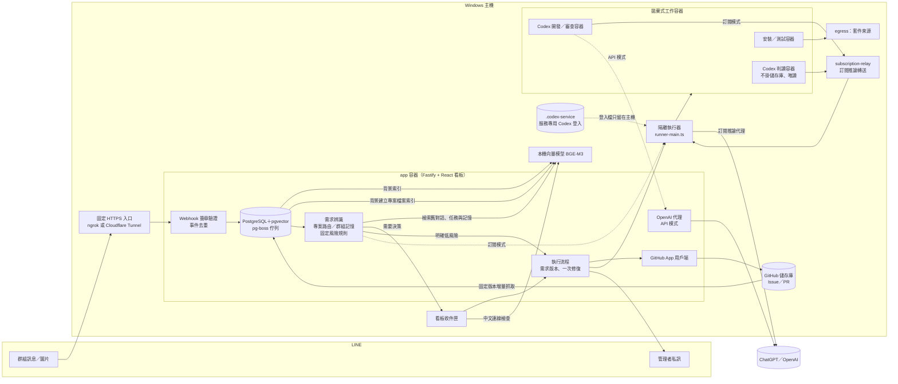

# 架構

系統由哪些元件組成、資料怎麼流動、工作容器如何隔離。部署步驟見 [部署手冊](deployment.md)。



| 元件                                                         | 位置               | 職責                                                                                                                                                                                                                                                                                     |
| ------------------------------------------------------------ | ------------------ | ---------------------------------------------------------------------------------------------------------------------------------------------------------------------------------------------------------------------------------------------------------------------------------------- |
| `server/app.ts`                                              | app 容器           | Webhook、管理 API、看板靜態檔、API 模式的 OpenAI 代理                                                                                                                                                                                                                                    |
| `server/triage.ts`                                           | app 容器           | 彙整訊息、呼叫 AI 判讀、專案路由、寫入群組記憶、風險規則                                                                                                                                                                                                                                 |
| `server/execution.ts`                                        | app 容器           | 建立 Issue、下載固定基底、安裝／開發／測試／審查、建立 PR                                                                                                                                                                                                                                |
| `server/jobs.ts`                                             | app 容器           | pg-boss 排程：判讀、派工、驗證、通知、清理與備份                                                                                                                                                                                                                                         |
| `server/github.ts`                                           | app 容器           | 依儲存庫找 GitHub App 安裝（可跨帳號與組織），串流下載封存檔                                                                                                                                                                                                                             |
| `server/runner-main.ts`                                      | 主機               | 唯一能操作 Docker 的程序；建立工作容器與階段推論授權，主登入資料留在可信主機                                                                                                                                                                                                             |
| `server/subscription-broker.ts`、`infra/subscription-relay/` | 主機／固定轉送容器 | 訂閱推論代理；檢查模型、階段、期限與用量，只轉送指定 Responses 路由                                                                                                                                                                                                                      |
| `worker/`                                                    | 工作容器           | Codex SDK 執行開發、審查與訂閱模式判讀；收集變更                                                                                                                                                                                                                                         |
| `src/App.tsx`、`src/app/`                                    | 瀏覽器             | 收件匣（統計卡、待決定事項、動態時間軸）、任務、聊天室、群組（綁定專案與記憶）、專案、設定；使用與生產情報助理相同的 shadcn/ui（Radix＋Tailwind CSS v4）元件，元件在 `src/components/ui/`，品牌標誌在 `src/components/brand.tsx`。品牌綠只用於主要操作、目前頁面與焦點，狀態色只用於狀態 |

## 一台伺服器上的組成

一個「實例」就是一台 Windows 主機上的一整套服務：自己的資料庫、佇列、機密、Codex 登入與對外網址。實例之間不共用任何狀態，沒有叢集或主從模式；多台部署就是把這一整套各裝一次（見〈[多台伺服器部署](deployment.md#多台伺服器部署)〉）。

**容器**（Docker Compose 專案 `line-agentflow`，常駐服務都在 `full` 設定檔）

| 服務                 | 映像來源                                  | 職責                                                                                    | 主機連接埠       |
| -------------------- | ----------------------------------------- | --------------------------------------------------------------------------------------- | ---------------- |
| `db`                 | `pgvector/pgvector:pg17`                  | PostgreSQL 17＋pgvector：全部資料與 pg-boss 佇列                                        | 不發布           |
| `app`                | 根目錄 `Dockerfile`                       | Webhook、管理 API、看板與背景工作；每次啟動自動套用資料庫遷移                           | `127.0.0.1:4310` |
| `egress`             | `infra/egress`（Squid）                   | 安裝階段的出口代理，只放行 npm、PyPI、NuGet                                             | 不發布           |
| `egress-ai`          | `infra/egress`（Squid）                   | 只放行 OpenAI／ChatGPT 的出口代理；目前的推論路徑不經過它，仍隨 `full` 啟動並列在系統頁 | 不發布           |
| `subscription-relay` | `infra/subscription-relay`                | 把工作容器的訂閱推論請求轉給主機上的訂閱代理                                            | 不發布           |
| `embedder`           | `text-embeddings-inference:cpu-1.9`       | 本機向量模型 BGE-M3，只有 `app` 連得到                                                  | 不發布           |
| `embedder-init`      | 同上（設定檔 `init`）                     | 一次性工作：下載並驗證模型權重                                                          | —                |
| `db-test`            | `pgvector/pgvector:pg17`（設定檔 `test`） | 自動測試專用資料庫，資料放在記憶體                                                      | `127.0.0.1:5439` |

工作容器不在 Compose 裡，由執行器逐次建立、用完即丟：映像 `line-agentflow-worker:local`（`worker/Dockerfile`，約 4.6 GB）執行 Codex、安裝與測試；`line-agentflow-source:local`（`infra/source/Dockerfile`，約 0.5 GB）準備原始碼。每個工作容器上限 2 GB 記憶體、2 顆 CPU、256 個程序，全系統一次只開發一個任務。

**主機上的 Node 程序**（不在容器裡，因為要操作 Docker 與持有訂閱登入）

| 程序                                 | 啟動方式                                         | 職責                                                                                                                                               | 監聽                                           |
| ------------------------------------ | ------------------------------------------------ | -------------------------------------------------------------------------------------------------------------------------------------------------- | ---------------------------------------------- |
| 監督程序 `scripts/start-windows.mjs` | 排程工作 `LINE-AgentFlow`，或 `npm run services` | 每 30 秒：Docker 可用時執行 `docker compose --profile full up -d`，執行器沒回應就啟動它，已設定入口就啟動通道；Docker Desktop 沒有執行時先把它啟動 | 無                                             |
| 隔離執行器 `server/runner-main.ts`   | 由監督程序啟動（手動：`npm run runner`）         | 唯一能操作 Docker 的程序；建立工作容器，並代管訂閱推論                                                                                             | `127.0.0.1:4312`（控制面）、`4313`（訂閱代理） |
| 通道 `scripts/tunnel.ts`             | 由監督程序啟動（手動：`npm run tunnel`）         | 以 ngrok 或 Cloudflare Tunnel（cloudflared）把固定 HTTPS 網域轉到 `127.0.0.1:4310`，並定時回報入口狀態                                             | 無                                             |
| 設定頁 `server/setup.ts`             | `npm run setup`，只在設定機密時執行              | 讓人在本機瀏覽器輸入機密                                                                                                                           | `127.0.0.1:4311`                               |

所有連接埠都只綁在主機回環介面，防火牆不需要開放任何輸入連接埠；外界唯一的入口是固定 HTTPS 通道：內建的 ngrok 或 Cloudflare Tunnel，或自備的通道（見〈[外部帳號設定](deployment.md#外部帳號設定)〉第 1 項）。使用 Cloudflare Tunnel 時，cloudflared 另外在 `127.0.0.1:4314` 提供本機狀態查詢。

**網路**（名稱固定，所以一台主機只能有一個正式實例）

| 網路                          | 連接對象                                                     |
| ----------------------------- | ------------------------------------------------------------ |
| `line-agentflow_default`      | 常駐服務之間，以及出口代理對外                               |
| `line-agentflow_workers`      | API 模式：工作容器 ↔ `app` 的推論代理                        |
| `line-agentflow_install`      | 安裝容器 ↔ `egress`                                          |
| `line-agentflow_ai`           | `egress-ai` 的內部網路                                       |
| `line-agentflow_subscription` | 訂閱模式：工作容器 ↔ `subscription-relay`                    |
| `line-agentflow_embed`        | `app` ↔ `embedder`                                           |
| `line-agentflow_open`         | 只在設定頁選了「完全開放容器網路」時由執行器建立；預設不存在 |

除了 `default` 與 `open`，其餘都是沒有對外路由的內部網路。

**資料卷**

| 資料卷                                  | 內容                                     | 遺失的後果                     |
| --------------------------------------- | ---------------------------------------- | ------------------------------ |
| `line-agentflow_database`               | PostgreSQL 資料                          | 全部資料遺失，只能從備份還原   |
| `line-agentflow_data`                   | `/data/backups`：每日加密備份，保留 7 份 | 失去備份                       |
| `line-agentflow_embed-models`           | BGE-M3 權重，約 2.3 GB                   | 重新執行 `embedder-init` 即可  |
| `agentflow-job-<執行 ID>`、`…-baseline` | 單次工作的工作目錄與比較基底             | 由執行器建立，保留期滿自動清理 |
| `agentflow-source-v1-*`                 | 專案原始碼快取                           | 下次派工重新下載               |

看板「系統」頁的 Docker 磁碟清理只會刪除名稱、`io.agentflow.*` 標籤與執行紀錄都對得上的任務工作區（`agentflow-job-*`）；上表其他資料卷一律只列出不刪，判斷寫在 `shared/docker-disk.ts` 的 `protectedVolumeReason`，執行器刪除前會再核對一次。
| `agentflow-production-nuget-feed-v1` | 選用的唯讀 NuGet 套件來源 | 回到一般下載流程 |

**主機上的檔案**（全部被 Git 忽略；除了搬機，不要從別台複製）

| 路徑                                     | 內容                                                                                                                                                                                                           |
| ---------------------------------------- | -------------------------------------------------------------------------------------------------------------------------------------------------------------------------------------------------------------- |
| `.env`                                   | `POSTGRES_PASSWORD`（`npm run init` 產生，只在資料庫資料卷第一次建立時生效）與 `ADMIN_GITHUB_ID`                                                                                                               |
| `.local/secrets.json`                    | LINE、GitHub App、入口（ngrok 或 Cloudflare）、OpenAI 憑證與自動產生的 `sessionSecret`、`runnerSecret`、`githubWebhookSecret`、公開網址；以唯讀方式掛進 `app` 的 `/config`，每次使用都重新讀取，修改後不必重啟 |
| `.codex-service/`                        | 服務專用的 Codex（ChatGPT 訂閱）登入，只留在主機                                                                                                                                                               |
| `.local/runner.log`、`.local/tunnel.log` | 執行器與通道的輸出                                                                                                                                                                                             |
| `.local/tunnel-status.json`              | 通道狀態；看板的「HTTPS 入口」檢查讀這個檔，超過 180 秒沒更新就視為異常                                                                                                                                        |
| `.local/supervisor.pid`                  | 監督程序的單一執行鎖                                                                                                                                                                                           |
| `.local/setup-url.txt`                   | 設定頁的一次性開啟連結，內含權杖，不要印出來                                                                                                                                                                   |

**資源用量**：常駐服務閒置時約占 3.5 GB 記憶體（其中向量模型約 2.7 GB），執行任務時再加一個最多 2 GB 的工作容器。映像與模型合計約 11 GB，另需保留工作資料卷與原始碼快取的空間。建議至少 16 GB 記憶體、40 GB 可用磁碟。

## AI 執行模式

- **訂閱模式（預設）**：使用服務專用的 ChatGPT 登入，額度計入訂閱方案，不需 API 金鑰。登入檔只在主機 `.codex-service/`，工作容器只取得綁定本次工作、階段、模型與期限的短效推論授權；不再注入或回收主登入檔。判讀、開發、修復與審查前共用額度檢查；額度耗盡或無法確認時保留訊息與工作，重新確認額度可用後才續跑，不會改用 API。可用結果快取 30 秒，阻擋結果快取 60 秒；供應商在呼叫途中回報耗盡也會阻擋後續呼叫。
- **API 模式**：使用 OpenAI API 金鑰，經應用程式內的代理限制模型並依預估金額記帳。

模式在看板「設定」切換，只影響之後開始的工作。

## 本機向量模型

既有安裝請先完成[資料卷升級與復原演練](records/rag-upgrade.md)。新安裝執行〈[部署手冊](deployment.md#步驟-5下載向量模型)〉步驟 5 時，初始化容器會從 Hugging Face 下載固定版本的 BGE-M3 並驗證權重，約需 2.3 GB 儲存空間。初始化會逐一核對六個模型檔案的雜湊，修復成功後以 `docker compose restart embedder` 重新載入。下載完成後由 CPU 容器以唯讀模式載入模型。僅應用容器能經專用內網連線，Windows 主機不需另外安裝模型。

在「設定 → AI 執行模式」勾選「本機 RAG」並儲存，到「服務連線」按「檢查連線」。顯示「正常」代表固定中文短句已取得 1,024 維向量。「需處理」時可查看原因及 `docker compose logs --tail 30 embedder`。正式環境預設停用。開啟後，新文字訊息、任務版本、群組記憶與專案記憶會在背景建立索引，收訊不用等模型。模型容器仍由 Compose 管理。

若要找回啟用前的討論，在「設定 → 對話、記憶與任務結果索引」按「補建索引」。這個按鈕會明確要求背景工作使用模型，即使尚未開啟自動檢索也可先補建；重按不會重複建立。可在同一處查看各類筆數和最近完成時間。「服務連線」分別顯示索引與判讀檢索狀態。模型離線時，索引稍後重試，判讀仍使用近期對話。

例如成員說「上週那個報表也要手機版」，判讀可找回同群組的舊討論與原任務。在任務詳情展開「判讀時參考的資料」，可看到相關任務及舊對話時間。撤回或超過保存期後，系統不再提供該訊息給判讀或詳情頁。

如果需求提到專案畫面，例如「WIP 即時看板欄位太窄」，判讀會從群組綁定的專案找出相關檔案和行號，並在建議方案引用實際路徑。啟用本機 RAG 後，專案通過環境驗證或判讀發現基底版本改變時，背景工作會建立檔案索引。在「專案」卡片可看見排程、索引中、完成段數或失敗原因。索引失敗後按原有上下文判讀，五分鐘後可重試索引。解除專案的最後一個群組綁定會刪除該索引。

開發與獨立審查會參考同專案最多三筆過往任務結果，例如上次手機畫面驗收缺少截圖。結果來自待合併、失敗與已合併的任務，審查仍依本次核准的需求進行。開啟 RAG 或綁定已驗證專案後會自動準備專案檔案索引。首批訊息可等待索引，從該批首則收訊起最多五分鐘，逾時或模型故障時沿用原有判讀。

## 專案檔案索引與範圍

大型專案的封存檔下載允許持續傳輸至 30 分鐘；連線或等候資料停滯 60 秒即中止，原因會顯示於專案卡片。索引仍只公開完整版本，失敗五分鐘後重試，不影響 LINE 收訊。

如果專案顯示超過 5,000 段，可在「專案 → 編輯 → 索引路徑範圍」指定需要檢索的檔案或目錄，每行一個儲存庫相對路徑，例如 `README.md`、`src/views`。留空表示全儲存庫的可索引文字；不支援萬用字元、絕對路徑或 `..`。儲存範圍會停用專案並作廢舊索引，重新驗證環境成功後會自動啟用。索引仍受原有敏感內容過濾與 5,000 段上限約束，卡片會顯示「所選範圍已完成」，不把它稱為全專案索引。任一路徑沒有合格文字或範圍仍超限時，會顯示原因而不發布部分索引。

索引範圍只決定 RAG 能檢索哪些檔案，不限制 Codex 的專案存取權，也不改變原始碼快取與下載內容。請依需要理解的功能選擇範圍，不要把一般程式加入「敏感路徑」來縮減索引。

部署後可開啟 `/docs/rag-flow-demo.html` 查看靜態流程展示頁與正式群組驗收文案。此頁隨 Vite 一起建置，不讀取群組資料；管理看板仍位於 `/`。

## 隔離與網路

| 階段           | 網路                                                   | 掛載                 |
| -------------- | ------------------------------------------------------ | -------------------- |
| 安裝           | 只能經 `egress` 連到 npm、PyPI、NuGet                  | 工作目錄             |
| 判讀（訂閱）   | 專用內網，只能經 `subscription-relay` 使用可信訂閱代理 | 無                   |
| 開發、審查     | 訂閱：固定訂閱代理；API：應用程式推論代理              | 工作目錄（審查唯讀） |
| 測試、收集差異 | 無網路                                                 | 工作目錄             |

所有工作容器以非 root、唯讀根目錄、移除全部 Linux capabilities 執行，拿不到主訂閱登入、GitHub 寫入憑證、LINE 機密、資料庫連線機密、Docker socket 或主機目錄。每個容器最多 512 個程序（容器內的 SQL Server 本身就需要兩百多個）。

擁有者在專案詳情登記的資料庫連線只由主機執行器使用：執行器連進資料庫擷取結構（不含資料），存成結構快照；之後每次驗證與任務都把快照以唯讀資料卷掛在工作容器的 `/agentflow/env/database`，由 AI 在容器內建立用完即丟的測試資料庫。測試階段維持無網路，工作容器不會連到真實資料庫。做法與界線見[專案環境自動設定](project-setup.md)。推分支與建立 PR 只由應用程式以 GitHub App 執行。

訂閱代理在主機回環介面使用 `4313`，執行器控制面仍為 `4312`；轉送容器不發布主機連接埠、不保存登入資料，只轉送指定的 POST Responses 路由。取消、清理或階段結束會撤銷授權。升級時需一併建置並啟動 `subscription-relay`；代理不可用會停止該次 AI 呼叫，不退回傳送登入檔或付費 API。驗收實例必須使用自己的內網、轉送服務及代理連接埠。

訂閱上游的等待標頭及串流共用該階段剩餘期限，使用原生 HTTPS 傳輸，避免底層用戶端在五分鐘先行中斷。取消會關閉連線；原有輸出上限、完整事件與用量驗證保持生效。

| 設定                               | 正式預設                         | 隔離驗收範例                         |
| ---------------------------------- | -------------------------------- | ------------------------------------ |
| `SUBSCRIPTION_BROKER_PORT`（主機） | 執行器埠加一，即 `4313`          | `14313`，不能使用正式 `4312`／`4313` |
| `SUBSCRIPTION_RELAY_URL`（執行器） | `http://subscription-relay:4313` | 同一驗收實例的固定轉送服務           |
| `BROKER_PORT`（轉送容器）          | `4313`                           | 對應該實例的 `14313`                 |

工作容器使用 [Codex 自訂 provider 設定](https://learn.chatgpt.com/docs/config-file/config-reference)，登入與刷新留在可信主機；相關登入機制見 [Codex 身分驗證文件](https://learn.chatgpt.com/docs/auth)。這不會建立新的付費 API 訂閱。代理的有界回應緩衝可能讓模型文字較晚出現，任務階段與容器狀態仍可在看板追蹤。

## 工作容器工具（重要）

**語言工具鏈（.NET、Python、Node 等）必須預先裝在工作映像**；專案相依套件預設由 AI 根據實際設定決定安裝命令，於安裝階段經 `egress` 下載。開發階段預設也可經同一個白名單下載 npm、PyPI、NuGet 套件（設定頁「開發時允許下載套件」），其他網址一律封鎖。

新增專案預設「AI 自動設定安裝與測試」，不必填指令。儲存後按「AI 自動設定並驗證」，系統讀取所選分支的固定 commit、CI、文件與套件設定，產生命令後在隔離容器安裝、驗證；成功才保存設定並自動啟用派工。詳情顯示實際命令及引用依據。只有建置檢查時明列「未執行自動測試」。資料庫或測試資料不足時不會停下來等人回答：AI 依序使用專案內的建庫腳本、擁有者提供的結構快照、從程式碼推測的結構；完整測試在模擬環境確實跑不了時才縮小範圍，並在專案卡片與 PR 標示「部分測試通過」及未涵蓋的範圍。

既有專案的人工設定保留於「進階設定：手動安裝與測試指令」，可切換為 AI 自動設定。自動設定按分支、設定版本及建置檔案雜湊重用；切換分支或建置設定改變時重新判讀，修改任務先驗證新基底再開發。套件及來源快取照常沿用。詳細手順與限制見[專案環境自動設定](project-setup.md)。

安裝與基底測試通過後，專案會自動啟用派工；失敗或環境設定已變更的舊驗證不會啟用。通過後仍可手動停用，驗證期間從啟用改為停用也會保留。全域暫停、群組啟用、專案綁定與任務審核等條件仍照常檢查。

新增或調整工具時：

1. 修改 `worker/Dockerfile`，用固定版本並在註解寫明用途。
2. 修改 `worker/*.mjs` 或工具鏈時，同步更新 Dockerfile 的 `io.agentflow.worker-rev` 與 `server/containers.ts` 的 `WORKER_REV`；執行器會拒絕較舊的映像，專案若指定自訂映像會在驗證或派工時明確提示要重建。
3. 重建映像：`docker build -f worker/Dockerfile -t line-agentflow-worker:local .`
4. 到看板「專案」頁對受影響的專案按「驗證環境」。

目前預裝：

| 工具                                                      | 用途                                                       |
| --------------------------------------------------------- | ---------------------------------------------------------- |
| Node.js 24、git                                           | 執行 Codex、前端專案、差異收集                             |
| Python 3、venv、pip                                       | Python 專案（相依套件裝在專案的 `.venv`）                  |
| make、g++                                                 | 需要編譯的 npm／pip 套件                                   |
| 無頭 Chromium＋Playwright 1.52（`require('playwright')`） | 前端畫面截圖驗收；截圖存到 `docs/`，審查員會開啟檢查       |
| fonts-noto-cjk                                            | 中文頁面截圖不會變成方塊字                                 |
| libusb                                                    | pyrealsense2 等硬體相關 Python 套件                        |
| ripgrep、jq、sqlite3、unzip                               | 程式碼搜尋與常見資料處理                                   |
| .NET 8 SDK 8.0.416（`dotnet`）                            | C# 專案建置與單元測試；NuGet 快取在 `/workspace/obj/nuget` |

C# 專案可讓 AI 根據實際方案與 CI 決定 `dotnet restore`、`dotnet test`。AI 自動設定時，系統從專案檔、套件與 CI 判斷測試是否需要 SQL Server，需要就自動改用含 SQL Server 的工作映像（`line-agentflow-worker-mssql:local`），測試階段在容器內啟動 SQL Server，並把寫死的 LocalDB 連線（`(localdb)\MSSQLLocalDB`）暫時導向它，結束時還原；判斷依據寫在環境設定說明，管理者可在進階設定改為「一律提供」或「不提供」。SQL Server 起不來時標示為「測試環境問題」而不是程式沒過。細節見 `docs/agents/project-environment.md`。結構可在專案詳情的「資料庫連線」擷取快照；沒有快照時由專案的遷移或建庫腳本建立，再不行由 AI 從程式碼推測結構。AI 縮小測試範圍時必須說明排除了什麼，系統會如實標示。進階設定仍可由管理者明確指定既有的測試範圍。專案的 `.gitignore` 沒有忽略 `bin/`、`obj/` 也沒關係：收集差異時會自動排除這次新產生的建置產物，見下方「收集差異時排除建置產物」。

尚未預裝、需要時再加入（加入前先評估映像大小）：

| 可能需要                               | 適用專案                     | 說明                                                                                                                         |
| -------------------------------------- | ---------------------------- | ---------------------------------------------------------------------------------------------------------------------------- |
| .NET Framework 4.x（ASP.NET MVC、IIS） | 舊版 MES 後端等舊專案        | Linux 容器無法建置，只能修改前端靜態檔或改用 Windows 容器                                                                    |
| SQL Server 測試資料庫                  | 讀寫 SQL Server 的 Loader    | 已提供衍生映像 `line-agentflow-worker-mssql:local`，AI 自動設定判斷需要時自動選用（見 `docs/agents/project-environment.md`） |
| PyTorch CPU 版                         | 需要實際跑模型推論的視覺專案 | 檔案很大，且需把 `download.pytorch.org` 加入安裝階段白名單                                                                   |
| 專案相依快取                           | npm／pip 專案                | 後續可為 npm／pip 加入跨任務快取；NuGet 已支援主機維護的唯讀套件來源                                                         |

## 專案原始碼快取

派工與專案環境驗證使用 `line-agentflow-source:local` 可信工具映像，首次升級必須先建立該映像，再更新並重啟 app 與主機 runner。只重建 app 不會更新主機執行器。缺少映像或新版執行器時會明確失敗，不偷偷退回大型封存檔下載。

相同 commit 直接複製本機快照；新 commit 以 Git 增量補齊缺少的物件，再建立快照。工作目錄和唯讀比較基底仍逐任務獨立；原始碼快取不等於共用 Codex 對話或相依套件快取。執行紀錄的「下載與準備專案／階段結束」會列出命中種類、抓取、快照及副本複製耗時。RAG 專案索引仍走原有的串流封存檔介面。

可重現的實測指令（需要本機已設定的 GitHub App，讀取儲存庫，不寫入遠端）：

```powershell
node --import tsx scripts/benchmark-source.mjs 擁有者/儲存庫 完整基底SHA 完整新版SHA .local/來源快取實測.json
```

腳本依序量基底、同版、新版及新版重複準備；既有快取不會被刪除，結果的 `cache` 才是實際冷／熱狀態。`wallMs` 包含重新驗證 GitHub 權限、容器啟動與準備；`addedObjectBytes` 是磁碟 Git 物件增量，不能當作網路流量。每份副本須通過零差異檢查，完成後移除測試工作 volume，快取保留供後續派工。

快取保存在 `agentflow-source-v1-*` volume，保留已抓取的 commit 物件與最後一份完整快照，不包含套件安裝產物。管理者須留意 Docker 磁碟空間；刪除專案或停止服務後可用 `docker volume ls --filter label=io.agentflow.source-cache=v1` 列出，再依實測報告的 `cacheVolume` 移除特定快取（`docker volume rm 完整名稱`）。不得執行全域 volume prune。快取不需要備份；刪除後會重新下載。不要在執行中移除或修改快取內容。

大型前端專案實測：相同版本準備由原正式紀錄的 606.9 秒降至 6.3 秒；新 commit 增量準備 20.1 秒。首次仍需要下載，且這是來源準備的比較，不是整個 Codex 執行時間。[完整量測方法與驗收結果](records/source-cache-verification.md)。

### NuGet 套件快取

主機執行器可在安裝階段掛載一份唯讀 NuGet 套件來源，專案環境驗證與派工均可使用。命中時，NuGet 從本機套件還原到該次工作的 `obj/nuget`；缺少的套件仍依專案設定取得。測試與後續階段直接讀取工作卷內的還原結果。

管理者可將已確認來自 NuGet.org 的公開 `.nupkg` 加入資料卷。以下以 Windows 主機已下載的 Playwright 套件為例。

```powershell
docker volume create --label io.agentflow.instance=production --label io.agentflow.nuget-feed=v1 agentflow-production-nuget-feed-v1
$package = Join-Path $env:USERPROFILE '.nuget\packages\microsoft.playwright\1.60.0\microsoft.playwright.1.60.0.nupkg'
docker run --rm --user 0:0 --network none --mount "type=bind,source=$package,target=/seed/microsoft.playwright.1.60.0.nupkg,readonly" --mount "type=volume,source=agentflow-production-nuget-feed-v1,target=/feed" line-agentflow-worker:local sh -ec 'cp /seed/microsoft.playwright.1.60.0.nupkg /feed/.playwright.tmp && mv /feed/.playwright.tmp /feed/microsoft.playwright.1.60.0.nupkg'
```

部署時更新主機執行器。套件由主機管理者加入，容器在驗證中下載的套件只保留於各自的工作卷。驗收實例使用獨立資料卷 `agentflow-verify-<suiteId>-nuget-feed-v1`，並將 `io.agentflow.instance` 標成同一個 `verify-<suiteId>`。沒有設定資料卷時沿用現有的下載流程。

## 收集差異時排除建置產物

收集 AI 的修改時，先排除常見的建置輸出，避免它們被當成修改送進 PR 或撐爆 10 MiB 上限：

| 類別   | 預設規則                                                  |
| ------ | --------------------------------------------------------- |
| .NET   | `bin/`、`obj/`、`TestResults/`                            |
| 前端   | `node_modules/`、`dist/`、`build/`、`.next/`、`coverage/` |
| Python | `__pycache__/`、`.pytest_cache/`、`*.pyc`                 |

- **只排除新檔案**：版本控制原本沒有追蹤的檔案才會被排除；原本就追蹤的檔案（例如專案自己提交的 `dist/app.js`）修改、刪除都照常收集。基底已經有追蹤檔案的目錄，裡面的新檔案也照常收集，因為那代表專案本來就提交建置結果。
- **規則寫法**：`名稱/` 是任何層的同名目錄；`a/b/` 是從儲存庫根目錄起的目錄；不含 `/` 的是任何層的檔名，含 `/` 的是從根目錄起的路徑；`*` 比對同一層內的任意字元。
- **專案增減**：看板專案頁「進階設定：收集時排除的建置產物」每行一條，`out/` 加入、`!dist/` 移除預設。調整不影響環境，不需要重新驗證。清單由伺服器算好後交給收集器（`shared/build-output.ts`），比對實作在 `worker/change-policy.mjs`；獨立審查重算變更時使用同一份清單。
- **回報**：被排除的路徑依目錄彙總（檔案數、大小、套用的規則），寫在 PR 說明的「收集時排除的建置產物」段落與任務紀錄，誤排除真正的修改時看得出來。

真的超過上限時，錯誤訊息列出最大的 10 個檔案與大小，標出看起來像建置產物的新檔案（例如在 `out/`、`target/` 底下，或是 `.dll`、`.pdb`），並建議把對應規則加入「收集時排除」；不像建置產物時則建議把中介產物移出交付。收集器不會因此刪除任何檔案。

## PR 圖片與驗收附件

每次提交上限為 200 個變更檔案、內容合計 10 MiB（自動排除的建置產物不計入）。畫面驗收請提交必要的前後代表圖與完整精簡結果報告，不把整套中介截圖目錄放入 Git。全流程驗收工具另保留完整矩陣證據。工作容器本機 Git SHA 與來源遠端 SHA 可能不同，報告應使用需求中的可信 `sourceVersion.baseCommit` 標明來源，不能將本機識別冒充遠端提交。

獨立審查會取得全部變更的可信差異與原始檔，不只依賴可能截斷的預覽。若完整證據超限、不一致或必要截圖缺失，工作會停止並顯示原因。審查先確認候選可以發布，PR 圖片及合併後畫面再由後續驗收確認；建立 PR 不等於畫面已部署。執行器連線可等待至工作期限，不再被五分鐘的標頭等待期限提早中斷，原有每任務三十分鐘上限不變。

自動建立 PR 時，發布器會把本次提交的 `docs/`、`screenshots/`、`artifacts/` 下 PNG、JPEG、WebP、GIF 加入說明；檔名包含 `-before-`／`-after-`（也支援底線、句點）的同組圖片並排顯示。`docs/` 的 Markdown 文件一併列出，連結固定於實際發布的 commit，避免分支後續更新造成圖片版本錯置。

最多內嵌 8 張圖片、列出 32 份附件，整段附件說明不超過約 24,000 字元；超出部分由 Files changed 查看。敏感路徑、刪除檔案、SVG 與一般產品素材不自動預覽。圖片存在不代表正式環境驗收通過，資料來源、模擬資料及驗證限制仍須記錄於驗收文件。沒有文字輸出的成功測試改顯示說明，不再留下空白程式碼框。已存在的 PR 不因重試覆寫管理者編輯；歷史 PR 可個別補上附件。

範例：某前端專案的 PR 已補齊 1440px 桌面與 390px 手機前後對照，以及驗收文件；使用本機示範資料，未連接正式環境。
