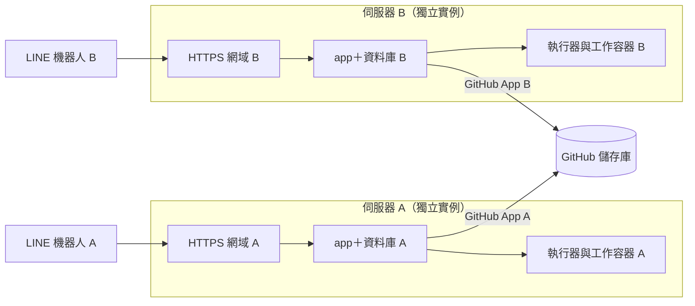

# 部署手冊

這份手冊是在一台全新伺服器上從零裝到可用的完整程序。指令都在儲存庫根目錄以 PowerShell 執行。

## 給 AI 代理的規則

1. **照順序做，逐步核對。** 每一步的「預期結果」不符就停下來，先查〈[疑難排解](#疑難排解)〉，不要帶著錯誤往下做。
2. **機密只由人輸入。** 標示「需要人」的步驟（設定頁、Codex 登入、Windows 自動登入、LINE／GitHub／ngrok／Cloudflare 後台）請使用者自己操作；你負責其餘指令與結果核對。不要請使用者把金鑰貼進對話。
3. **不讀出機密檔。** 不要顯示 `.env`、`.local/secrets.json`、`.local/setup-url.txt`、`.codex-service/` 的內容；需要用到時只在指令裡引用，像本手冊的範例那樣。
4. **不刪資料卷。** 不執行 `docker compose down -v`、`docker volume prune`、`docker system prune --volumes`。
5. **部署目錄只用來部署，不在裡面開發。** 監督程序每 30 秒用這個目錄的 `compose.yaml` 執行 `up -d`；在這裡切到改過 `compose.yaml` 的分支，正式容器會被重建。部署目錄只由 `npm run deploy` 更新，它固定切到 `origin/main`（分離 HEAD，不需要本機的 `main` 分支）。要開發請另外 clone 一份，或用 `git worktree add ..\chat2pr-dev -b 分支名稱 origin/main` 開一個工作目錄。開發目錄沒有 `.local/secrets.json`，`npm run deploy` 會拒絕執行；和正式服務同一台主機時，也不要在開發目錄執行 `docker compose up`（Compose 專案名稱是固定的，會動到正式容器）。
6. **升級一律用 `npm run deploy`。** 它會先確認沒有執行中的任務，並在結束時執行冒煙測試；需要手動重啟時也要先做同樣的確認（指令見〈[升級](#升級)〉）。
7. **新實例預設全域暫停。** 在〈[步驟 10](#步驟-10看板驗收並開始使用)〉驗收完成前不要開啟自動派工。

## 支援環境與需求

| 項目     | 需求                                                                                                                                          |
| -------- | --------------------------------------------------------------------------------------------------------------------------------------------- |
| 作業系統 | Windows 11＋Docker Desktop（Linux 容器）。這是唯一實際驗證過的組合                                                                            |
| 軟體     | Node.js 24、Git、Docker Desktop（含 Compose v2）。已驗證版本：Node 24.18、Docker 29.8、Compose 5.5                                            |
| 硬體     | 建議 16 GB 記憶體、40 GB 可用磁碟（依據見〈[一台伺服器上的組成](architecture.md#一台伺服器上的組成)〉）                                       |
| 對外連線 | 只需要輸出：GitHub、LINE、ngrok 或 Cloudflare、ChatGPT／OpenAI、npm、Docker Hub、ghcr.io，首次安裝另需 Hugging Face。不需要開放任何輸入連接埠 |
| 帳號     | 見下一節                                                                                                                                      |

**Linux 主機目前不能直接部署**：`app` 與 `subscription-relay` 經 `host.docker.internal` 連到只監聽 `127.0.0.1` 的主機執行器（Docker Desktop 會轉到主機回環，Linux 的 Docker Engine 不會）；`npm run install:startup` 只支援 Windows 工作排程器。要支援 Linux 需要先改程式，不是調設定能解決的。

**一台主機只能有一個正式實例**：Compose 專案名稱、連接埠與網路名稱都是固定的。

## 每台伺服器要準備的資源

| 資源                                                                            | 能不能和別台共用 | 說明                                                                                                                                                                                |
| ------------------------------------------------------------------------------- | ---------------- | ----------------------------------------------------------------------------------------------------------------------------------------------------------------------------------- |
| 固定 HTTPS 網址（ngrok 固定網域＋Authtoken，或 Cloudflare Tunnel 與自己的網域） | 不能             | 一個網域同時只能連到一台。ngrok 免費帳號只有一個固定網域，所以每台要各自的 ngrok 帳號，或使用可建立多個網域的方案；Cloudflare Tunnel 可以在同一個網域下為每台建立各自的子網域與通道 |
| LINE Messaging API channel（機器人）                                            | 不能             | 一個 channel 只能設定一個 Webhook 網址，每台各建一個機器人                                                                                                                          |
| GitHub App                                                                      | 不能             | 一個 App 只有一個 Webhook 網址，每台各建一個 App；可以安裝到同樣的帳號與組織                                                                                                        |
| ChatGPT 訂閱登入（訂閱模式）                                                    | 帳號可以相同     | 每台各自執行 `npm run codex:login`，不要複製 `.codex-service/`。同一個帳號的訂閱額度由所有伺服器共用；看板的每日執行次數上限是每台各算各的                                          |
| OpenAI API 金鑰（只有 API 模式需要）                                            | 可以             | 建議每台用不同金鑰，方便分帳與撤銷                                                                                                                                                  |
| 擁有者的 GitHub 數字 ID                                                         | 可以相同         | 寫在每台的 `.env`（`ADMIN_GITHUB_ID`）                                                                                                                                              |
| 資料庫密碼、`sessionSecret`、`runnerSecret`、GitHub Webhook Secret              | 不能             | 安裝時自動產生，每台不同，不需要也不應該複製                                                                                                                                        |

## 安裝步驟

### 步驟 0：前置檢查

```powershell
node --version
git --version
docker compose version
docker info --format "{{.OSType}} {{.ServerVersion}}"
```

預期結果：Node 為 `v24.x`；最後一行是 `linux` 加版本號。出現連線錯誤代表 Docker Desktop 還沒啟動；顯示 `windows` 代表 Docker Desktop 要切回 Linux 容器。

### 步驟 1：取得程式碼與相依套件

```powershell
git clone https://github.com/<你的帳號>/chat2pr.git
cd chat2pr
npm ci
```

預期結果：`npm ci` 結束時沒有錯誤，目前分支是 `main`。這份工作目錄之後就是這台伺服器的部署目錄，不要搬動或改分支。

### 步驟 2：產生本機設定並指定擁有者

```powershell
npm run init
```

預期結果：顯示「本機環境設定已準備。請執行 npm run setup 填入服務憑證。」，並出現 `.env`（內含隨機的 `POSTGRES_PASSWORD`）與 `.local\`。`.env` 已存在時不會覆寫。還沒指定擁有者時會多一行提醒，照下一段補上即可。

接著把擁有者寫進 `.env`。擁有者是固定的管理者，要填 GitHub 的**數字 ID**，不是帳號名稱；用 `gh api users/帳號 --jq .id` 查，或開啟 `https://api.github.com/users/帳號` 看 `id` 欄位。

```powershell
Add-Content .env "ADMIN_GITHUB_ID=這裡換成數字ID"
```

這一行是必填：沒有設定時 `app` 不會啟動，`npm run deploy` 也會拒絕執行。之後要更換擁有者：修改 `.env` 這一行，再執行 `docker compose --profile full up -d app`。

注意：`POSTGRES_PASSWORD` 只在資料庫資料卷第一次建立時生效。資料卷建立後不要重新產生或修改 `.env` 的密碼，否則 `app` 會連不上資料庫。

### 步驟 3：填入機密（需要人）

```powershell
npm run setup
```

這個程式會持續執行，請在另一個終端機或背景啟動。預期結果：顯示「本機機密設定頁已啟動。專用開啟連結已存入 .local/setup-url.txt，連結僅在此程序有效。」同時自動產生 `sessionSecret`、`runnerSecret` 與 GitHub Webhook Secret。

替使用者開啟設定頁（連結含一次性權杖，不要印出來）：

```powershell
Start-Process (Get-Content .local\setup-url.txt)
```

由人在設定頁依〈[外部帳號設定](#外部帳號設定)〉逐區填寫並儲存。欄位留空不會覆蓋已儲存的值，所以可以分次儲存，之後要換某一個憑證也是重新執行 `npm run setup` 只填那一欄。全部存好後在執行 `npm run setup` 的終端機按 Ctrl+C 結束。

機密存在 `.local/secrets.json`，設定程式會把 `.local` 的 Windows 權限限制為只有目前使用者可存取。修改後不必重啟 `app`。

### 步驟 4：建置工作映像

```powershell
docker build -f worker/Dockerfile -t line-agentflow-worker:local .
docker build -f infra/source/Dockerfile -t line-agentflow-source:local .
```

預期結果：`docker image ls line-agentflow-worker:local` 與 `docker image ls line-agentflow-source:local` 各列出一個映像（約 4.6 GB 與 0.5 GB）。第一次建置要下載 .NET SDK、Chromium 等工具，時間視網路而定。

### 步驟 5：下載向量模型

```powershell
docker compose --profile init run --rm embedder-init
```

預期結果：最後一行是「本機向量模型已下載並驗證」（約 2.3 GB，逐檔核對雜湊）。重複執行會顯示「模型已就緒」。不打算使用本機 RAG 也要執行，否則 `embedder` 容器無法正常啟動。

### 步驟 6：啟動常駐服務

```powershell
docker compose --profile full up -d --build
docker compose --profile full ps --format "table {{.Service}}\t{{.State}}\t{{.Health}}"
Invoke-RestMethod http://127.0.0.1:4310/health
```

預期結果：`app`、`db`、`egress`、`egress-ai`、`embedder`、`subscription-relay` 六個服務都是 `running`，`db` 為 `healthy`；最後一個指令回傳 `ok` 為 `True`。`app` 第一次啟動會自動建立資料表。

### 步驟 7：登入 Codex 訂閱（需要人；API 模式可略過）

```powershell
npm run codex:login
```

瀏覽器會開啟 ChatGPT 登入頁，由人完成登入。主機沒有瀏覽器時改用 `npm run codex:login -- --device-auth`，依畫面在另一台裝置輸入代碼。預期結果：出現 `.codex-service\auth.json`。這份登入只給這個服務使用，與使用者個人的 Codex 登入分開。

### 步驟 8：註冊開機自動啟動，並啟動主機程序

```powershell
npm run install:startup
Start-ScheduledTask -TaskName 'LINE-AgentFlow'
```

預期結果：第一個指令顯示「已設定 Windows 登入後恢復服務；Docker Desktop 沒有執行時會自動啟動。無人值守的主機請另外設定 Windows 自動登入。」排程工作會在使用者登入時啟動監督程序，並每 5 分鐘補啟動一次。等大約一分鐘後核對執行器與通道：

```powershell
$k = (Get-Content .local\secrets.json -Raw | ConvertFrom-Json).runnerSecret
Invoke-RestMethod http://127.0.0.1:4312/health -Headers @{ 'x-runner-key' = $k }
(Get-Content .local\tunnel-status.json -Raw | ConvertFrom-Json).ok
```

預期結果：第二行回傳 `ok=True`、`instance=production`、`subscriptionBroker=v1`；第三行是 `True`。

重開機後的恢復：

- **Docker Desktop 不需要另外設定登入時啟動。** 監督程序發現 Docker 沒有回應時會自己啟動 Docker Desktop（每 3 分鐘最多嘗試一次，紀錄寫在 `.local\supervisor.log`），Docker 就緒後再把容器、執行器與通道拉起來。
- **無人值守的主機要設定 Windows 自動登入（需要人）。** 排程工作以互動式登入執行，沒有人登入 Windows 就不會啟動。自動登入牽涉帳號密碼，由人設定，AI 代理不要代做：使用 Microsoft Sysinternals 的 Autologon（密碼以 LSA 加密保存）。自動登入代表能接觸這台主機的人不必密碼就能進入桌面，主機應放在受控的環境並啟用磁碟加密。不設定的話，每次重開機後要有人登入一次。
- 設定完成後重開機驗收一次：不做任何操作，大約五分鐘後執行 `npm run smoke` 應全部通過。

### 步驟 9：完成外部串接（需要人）

1. LINE Developers Console：Webhook URL 設為 `https://固定網址/webhooks/line`，按 Verify 應顯示成功，並開啟 Use webhook。
2. GitHub：把這台的 GitHub App 安裝到要讓機器人修改的帳號或組織，只勾選需要的儲存庫。
3. 從外部確認入口：`Invoke-RestMethod https://固定網址/health` 回傳 `ok` 為 `True`。

### 步驟 10：看板驗收並開始使用

用固定 HTTPS 網址開啟看板，以擁有者的 GitHub 帳號登入。收件匣的「開始使用」卡片會列出六個啟用步驟，依序完成：

1. **服務連線正常**：「設定 → 服務連線」按「檢查連線」，LINE、GitHub App、隔離執行器、HTTPS 入口都要是「正常」。
2. **Codex 已登入訂閱**（或 API 模式的「OpenAI API 可用」）。
3. **至少一個專案通過驗證**：在「專案」新增專案，寫好「說明」（AI 依此分派需求），選儲存庫與基底分支，填敏感路徑，儲存後按「AI 自動設定並驗證」；通過後專案自動啟用。要自訂安裝／測試命令時展開「進階設定：手動安裝與測試指令」，說明見[專案環境自動設定](project-setup.md)。
4. **群組已綁定專案並啟用**：把這台的 LINE 機器人加進群組，在「群組」頁勾選可修改的專案並啟用。機器人剛加入的群組預設停用。
5. **LINE 私訊通知已配對**：在「設定」產生一次性配對碼，用 LINE 私訊傳給機器人。
6. **開始自動派工**：先在測試群組送一則 `/任務` 驗收整個流程，確認無誤後再用右上角的開關取消全域暫停。

其他管理者與成員在「成員」頁以 GitHub 帳號加入。

## 外部帳號設定

每台伺服器各做一次，對應設定頁的四個區塊。

1. **固定 HTTPS 入口**：在設定頁「入口方式」選一種，把完整網址（`https://網域`，不要結尾斜線）填入「固定公開網址」並儲存。網址必須是 HTTPS。儲存後設定頁會顯示這台的 GitHub Callback 與 Webhook 網址。程式不會購買資源或升級方案。
   - **ngrok（內建）**：在 ngrok 後台取得 Authtoken 與固定網域，把 Authtoken 填入設定頁。
   - **Cloudflare Tunnel（內建，使用自己的網域）**：主機先安裝 cloudflared（`winget install Cloudflare.cloudflared`；也可以把 `cloudflared.exe` 放在 `.local\`，或用環境變數 `CLOUDFLARED_PATH` 指定路徑），再擇一提供憑證：
     - 後台管理的通道（建議）：在 Cloudflare Zero Trust → Networks → Tunnels 建立通道，公開主機名稱的服務填 `http://127.0.0.1:4310`，把通道權杖貼到設定頁。權杖只經環境變數交給 cloudflared，不會出現在程序列表。
     - 本機管理的通道：已經用 `cloudflared tunnel create` 建好通道時，填設定檔（`config.yml`）的完整路徑；設定檔的 `ingress` 要把網域指到 `http://127.0.0.1:4310`。兩者都填時使用權杖。

     通道程式每 30 秒檢查 cloudflared 的連線狀態與公開網址的 `/health`，把結果寫入 `.local\tunnel-status.json`；cloudflared 結束時會自動重新啟動。本機狀態連接埠預設是 `127.0.0.1:4314`，同一台主機另有 cloudflared 佔用時，以環境變數 `CLOUDFLARED_METRICS_PORT` 改用其他連接埠。

   - **自備入口（不由本系統啟動）**：使用其他通道或反向代理時選這一項，並滿足下列條件：
     - 把固定 HTTPS 網域轉到 `http://127.0.0.1:4310`。
     - 自備一個常駐程序維持通道，並至少每 180 秒改寫一次 `.local/tunnel-status.json`，內容為 `{"ok":true,"detail":"說明文字","checked_at":"ISO 8601 時間"}`。看板「HTTPS 入口」與異常通知讀的就是這個檔，沒有程序更新就會顯示異常。
     - 這個程序要自己設定登入後啟動（例如另一個排程工作）；`npm run deploy` 不會重啟它，也不會動到它。

   更換入口方式或憑證後，執行 `npm run deploy -- --restart-host`，讓監督程序與通道用新設定重新啟動。沒有選過入口方式的舊安裝維持原本的行為：填過 Cloudflare 憑證就使用 Cloudflare，否則填過 ngrok Authtoken 就使用 ngrok，兩者都沒有就不啟動內建通道。

   更換入口網域時，設定頁的公開網址、LINE Webhook 網址與 GitHub App 的 Homepage／Callback／Webhook URL 要一起改。

2. **LINE**：在 LINE Developers Console 建立這台專用的 Messaging API channel，把 Channel Secret 與 Channel Access Token 填入設定頁。啟用 Allow bot to join group chats。Webhook 網址等步驟 9 再設定。LINE 的「隱私權政策及服務條款」網址欄位是選填；正式收取群組訊息前，應讓成員知道訊息會送交 AI 與 GitHub 工作流程處理。
3. **GitHub App**：建立這台專用的 App。
   - Homepage URL：`https://固定網址`
   - Callback URL：`https://固定網址/auth/github/callback`
   - Webhook URL：`https://固定網址/webhooks/github`；Webhook Secret 用設定頁的「複製已產生的 Webhook Secret」
   - Repository permissions：Contents、Issues、Pull requests 設為 Read and write；Checks、Actions、Metadata 設為 Read-only
   - 訂閱事件：Pull request、Check run、Repository（儲存庫被刪除、改名或轉移時，對應的專案才會即時停用或跟著更新）
   - 要安裝到組織或其他帳號時，在 App 設定按「Make public」
   - 把 App ID、Client ID、Client Secret 與 Private key（PEM 完整內容）填入設定頁。Installation ID 可留空，服務會依儲存庫自動找對應的安裝
4. **AI**：訂閱模式不需要填任何欄位（步驟 7 登入即可）。API 模式才把 OpenAI 專案金鑰填入設定頁，並在看板「設定」切換模式；判讀與開發的模型可在「設定」選擇 `gpt-5.4-mini` 或 `gpt-6.1-sol`。

## 部署完成檢查表

逐項確認後才算部署完成：

| 檢查         | 指令或位置                                       | 預期                                                                       |
| ------------ | ------------------------------------------------ | -------------------------------------------------------------------------- |
| 六個常駐容器 | `docker compose --profile full ps`               | 全部 `running`，`db` 為 `healthy`                                          |
| 應用程式     | `Invoke-RestMethod http://127.0.0.1:4310/health` | `ok` 為 `True`                                                             |
| 執行器       | 步驟 8 的 `4312/health` 指令                     | `instance=production`、`subscriptionBroker=v1`                             |
| 通道         | 步驟 8 的 `tunnel-status.json` 指令              | `True`                                                                     |
| 外部入口     | `Invoke-RestMethod https://固定網址/health`      | `ok` 為 `True`                                                             |
| 冒煙測試     | `npm run smoke`                                  | 全部通過                                                                   |
| 開機自動啟動 | `Get-ScheduledTask -TaskName 'LINE-AgentFlow'`   | 存在，狀態為 `Ready` 或 `Running`                                          |
| 服務連線     | 看板「設定 → 服務連線 → 檢查連線」               | 目前 AI 模式需要的項目全部「正常」                                         |
| 啟用步驟     | 看板收件匣                                       | 六步全部完成後，「開始使用」卡片不再顯示                                   |
| 機密備份     | 人工                                             | `.local/secrets.json` 已另外安全保存（還原備份需要其中的 `sessionSecret`） |

## 升級

在部署目錄執行一個指令：

```powershell
npm run deploy
```

它依序做下面的事，任何一步失敗就停下來並說明原因：

1. 確認部署目錄沒有未提交的修改、`.env` 已設定 `ADMIN_GITHUB_ID`，也沒有排隊或執行中的任務；不符合就拒絕部署。
2. 取得 `origin/main` 並切過去。已經是最新版本時只執行冒煙測試。
3. 相依套件有變更時，先停止主機程序再執行 `npm ci`。
4. 建置工作映像與原始碼映像（沒有變更時直接使用快取），建置並重啟服務容器。資料庫遷移在 `app` 啟動時自動執行。
5. 重啟主機執行器。`scripts/start-windows.mjs`、通道程式或相依套件有變更時，連同監督程序與通道一起重啟。
6. 等 `app` 與執行器恢復後執行冒煙測試。

| 指令                               | 用途                                                                           |
| ---------------------------------- | ------------------------------------------------------------------------------ |
| `npm run deploy`                   | 更新到 `origin/main` 並部署                                                    |
| `npm run deploy -- --restart-host` | 連同監督程序與通道一起重啟（更換入口設定後使用）；版本沒有變也會重新建置與重啟 |
| `npm run deploy -- --rebuild`      | 版本沒有變也重新建置與重啟                                                     |
| `npm run smoke`                    | 只執行冒煙測試，不更新任何東西                                                 |

冒煙測試只送唯讀或一定會被拒絕的請求，隨時可以執行。它檢查：`app` 與資料庫的 `/health`、看板頁面、管理 API 未登入時回 401、LINE 與 GitHub Webhook 拒絕未簽章的請求、主機執行器的身分、對外入口的 `/health`，以及通道狀態檔是否在 3 分鐘內更新。看板「系統」頁有異常項目時只會提醒，不算失敗。

- 工作映像的版本比程式要求的舊時，執行器會拒絕派工並提示重建。工作映像有更新時，部署結束會提醒到「專案」頁對受影響的專案重新驗證（按「AI 自動設定並驗證」，手動設定的專案按「驗證環境」）。
- 自備入口的通道程序不會被重啟，也不會被動到。
- 重啟全部主機程序時，同一台主機上隔離驗收用的執行器也會被結束。
- 第一次升級到含有 `npm run deploy` 的版本時，部署目錄裡還沒有這個指令，照下面的手動步驟做一次。

**手動步驟**（`npm run deploy` 失敗、需要逐步排查時使用）。先確認沒有排隊或執行中的任務，結果必須是 `0`：

```powershell
docker compose exec db psql -U agentflow -d agentflow -Atc "SELECT count(*) FROM tasks WHERE status IN ('queued','running','reviewing')"
```

再更新程式、重建映像並重啟：

```powershell
git fetch origin --prune
git switch --detach origin/main
npm ci
docker build -f worker/Dockerfile -t line-agentflow-worker:local .
docker build -f infra/source/Dockerfile -t line-agentflow-source:local .
docker compose --profile full up -d --build
Get-CimInstance Win32_Process -Filter "Name='node.exe'" | Where-Object { $_.CommandLine -match 'runner-main\.ts' } | ForEach-Object { Stop-Process -Id $_.ProcessId -Force }
```

最後一行結束主機執行器；監督程序會在 30 秒內用新程式重新啟動它。只重建 `app` 不會更新執行器。`scripts/start-windows.mjs` 或 `scripts/tunnel.ts` 有變更時，改為重啟全部主機程序：

```powershell
Stop-ScheduledTask -TaskName 'LINE-AgentFlow'
Get-CimInstance Win32_Process -Filter "Name='node.exe'" | Where-Object { $_.CommandLine -match 'start-windows\.mjs|runner-main\.ts|tunnel\.ts' } | ForEach-Object { Stop-Process -Id $_.ProcessId -Force }
Start-ScheduledTask -TaskName 'LINE-AgentFlow'
```

完成後執行 `npm run smoke`。

## 外部健康監控

看板的異常通知由 `app` 自己經 LINE 發出；整台主機、Docker 或通道斷線時它發不出來。要在這種情況收到通知，必須由主機以外的服務定時檢查 `https://固定網址/health`（不需要登入，正常時回應 200）。

儲存庫內建 GitHub Actions 工作流程 `.github/workflows/health-monitor.yml`，預設不啟用。設定儲存庫變數 `HEALTH_URLS` 就會啟用，內容是各伺服器的公開網址，以空白分隔：

```powershell
gh variable set HEALTH_URLS --body "https://網域A https://網域B"
```

- 每 6 小時檢查一次。某個網址連續三次（間隔 30 秒）沒有回應 200，就開一張標籤為 `health-monitor` 的 Issue，GitHub 會寄信給關注這個儲存庫的人。已有開著的告警時不重複開立，全部恢復後自動關閉。
- 立即測試：`gh workflow run health-monitor.yml`，再用 `gh run list --workflow health-monitor.yml --limit 1` 看結果。
- 停用：`gh variable delete HEALTH_URLS`。沒有這個變數時工作直接略過，不佔用 Actions 分鐘數。
- 成本：私人儲存庫每次執行至少計 1 分鐘，每 6 小時一次大約每月 120 分鐘，計入 GitHub 免費方案每月 2,000 分鐘的額度；公開儲存庫不計費。要更快發現斷線可以把工作流程的 `cron` 改密，分鐘數等比例增加。GitHub 的排程可能延遲數分鐘到數十分鐘。
- 需要分鐘級的告警時，改用專門的監控服務（例如 UptimeRobot、healthchecks.io，或 Cloudflare 的通道健康通知），同樣檢查 `/health`。這些服務的帳號由人自行註冊與設定。

## 備份、還原與搬機

每天凌晨 3 點（臺北時間）自動備份到資料卷 `line-agentflow_data` 的 `/data/backups`，保留 7 份。備份包含設定、成員名單、專案、群組、任務與記錄；不含原始聊天、圖片、登入工作階段、向量索引與工作容器內容。檔案以這台的 `sessionSecret` 加密（AES-256-GCM），**沒有原本的 `sessionSecret` 就無法還原**。

備份和資料庫在同一台主機上，主機損毀會一起遺失，請定期複製到別處，並另外安全保存 `.local/secrets.json`：

```powershell
docker compose exec app npm run backup
docker compose exec app ls /data/backups
New-Item -ItemType Directory -Force C:\af-backup
docker cp line-agentflow-app-1:/data/backups/agentflow-2026-11-10.afbackup C:\af-backup\
```

**還原到新伺服器（搬機）**。還原只接受空白資料庫，所以要在新伺服器第一次啟動 `app` 之前做：

1. 舊伺服器先停止服務（見下一節），避免兩台同時使用同一個網址、LINE channel 與 GitHub App。
2. 新伺服器完成步驟 0 到 2。
3. 把舊伺服器的 `.local\secrets.json` 複製到新伺服器的 `.local\`，再執行步驟 3（`npm run setup` 會保留既有的值；網址或憑證有變才需要重填）。
4. 完成步驟 4、5，然後只啟動資料庫並還原：

   ```powershell
   docker compose --profile full build app
   docker compose up -d db
   docker compose run --rm --no-deps -v "C:\af-backup:/restore:ro" app npm run restore -- /restore/agentflow-2026-11-10.afbackup
   ```

   預期結果：顯示「還原完成。系統維持暫停，請重新驗證專案與遠端 PR 後啟用。」

5. 繼續步驟 6 到 10。

還原後的狀態：全域暫停、所有群組停用、所有專案需要重新驗證環境，原本排隊或執行中的任務會標成失敗並註明「由備份還原」，重試前先到 GitHub 核對遠端的分支與 PR。所有人需要重新登入。備份第 3 版起才包含成員名單；還原更早的備份時程式會提示，此時只有擁有者能登入，要到「成員」頁重新加入其他人。如果新伺服器換了 LINE 機器人，要把新機器人加進群組並重新配對私訊通知。

在同一台主機上原地還原、手動指定資料庫等其他做法見[操作與驗收](operations.md)。

## 停止與移除

暫時停止（保留全部資料）：先停用排程工作，否則監督程序會在 30 秒內把服務拉回來。

```powershell
Stop-ScheduledTask -TaskName 'LINE-AgentFlow'
Disable-ScheduledTask -TaskName 'LINE-AgentFlow'
Get-CimInstance Win32_Process -Filter "Name='node.exe'" | Where-Object { $_.CommandLine -match 'start-windows\.mjs|runner-main\.ts|tunnel\.ts' } | ForEach-Object { Stop-Process -Id $_.ProcessId -Force }
docker compose --profile full stop
```

恢復：`Enable-ScheduledTask -TaskName 'LINE-AgentFlow'` 後執行 `Start-ScheduledTask -TaskName 'LINE-AgentFlow'`。

永久移除一台伺服器：先照上面停止並把備份與 `.local/secrets.json` 複製出來，再執行 `Unregister-ScheduledTask -TaskName 'LINE-AgentFlow'`，最後才用 `docker compose --profile full down -v` 刪除容器與資料卷（這一步無法復原，只在確定要廢棄這台時由人決定）。另外到 LINE、GitHub 與 ngrok 或 Cloudflare 後台停用這台專用的 channel、App、網域與通道。

## 疑難排解

| 症狀                                             | 可能原因                                                                                                                                                                                                      | 處理                                                                                                                                                                      |
| ------------------------------------------------ | ------------------------------------------------------------------------------------------------------------------------------------------------------------------------------------------------------------- | ------------------------------------------------------------------------------------------------------------------------------------------------------------------------- |
| `docker compose` 顯示「請先執行 npm run init」   | `.env` 不存在或缺 `POSTGRES_PASSWORD`                                                                                                                                                                         | 執行 `npm run init`；資料卷已存在時要放回原本的 `.env`，不要重新產生                                                                                                      |
| `app` 不斷重啟，日誌出現資料庫密碼驗證失敗       | `.env` 的密碼和資料卷建立時不同                                                                                                                                                                               | 還原原本的 `.env`。全新安裝且確定沒有資料時，才可以刪除 `line-agentflow_database` 資料卷重來                                                                              |
| `app` 啟動後立即結束，日誌顯示「缺少擁有者」     | `.env` 沒有 `ADMIN_GITHUB_ID`，或不是數字                                                                                                                                                                     | 在 `.env` 加上 `ADMIN_GITHUB_ID=擁有者的 GitHub 數字 ID`，再執行 `docker compose --profile full up -d app`                                                                |
| `embedder` 啟動失敗                              | 沒有執行步驟 5，或模型檔損毀                                                                                                                                                                                  | 重跑 `docker compose --profile init run --rm embedder-init`，再 `docker compose restart embedder`                                                                         |
| 看板「隔離執行器」異常，或 `4312/health` 連不上  | 監督程序沒有執行，或執行器啟動失敗                                                                                                                                                                            | 確認排程工作狀態，查看 `.local\runner.log`；臨時可在前景執行 `npm run services` 觀察                                                                                      |
| 看板「HTTPS 入口」異常                           | 入口方式的憑證或公開網址沒有填；主機沒有安裝 cloudflared；Cloudflare 通道的公開主機名稱沒有指到 `http://127.0.0.1:4310`；同一個固定網域已在另一台連線；ngrok 額度用完；自備入口的通道程序停了或沒有更新狀態檔 | 先看看板「系統」頁「HTTPS 入口」的說明文字，再查看 `.local\tunnel.log`（自備入口看自己的通道程序與 `.local\tunnel-status.json` 的更新時間）；每台伺服器必須使用自己的網域 |
| LINE 的 Verify 失敗                              | 通道未啟動、Webhook 網址填錯，或 Channel Secret 不屬於這個 channel                                                                                                                                            | 先確認外部入口的 `/health`，再核對設定頁的 LINE 欄位                                                                                                                      |
| 擁有者用 GitHub 登入被拒絕，或登入後沒有管理功能 | `ADMIN_GITHUB_ID` 填成帳號名稱或別人的 ID                                                                                                                                                                     | 改成正確的數字 ID 後執行 `docker compose --profile full up -d app`                                                                                                        |
| GitHub 登入時顯示 redirect 相關錯誤              | GitHub App 的 Callback URL 與這台的固定網址不一致                                                                                                                                                             | 依設定頁顯示的 Callback 網址修正 App 設定                                                                                                                                 |
| 派工時提示工作映像版本過舊                       | 升級後沒有重建工作映像                                                                                                                                                                                        | 重跑步驟 4，再到「專案」頁重新驗證                                                                                                                                        |
| 看板「Codex 訂閱登入」異常                       | 還沒登入或登入已失效                                                                                                                                                                                          | 重跑步驟 7                                                                                                                                                                |
| `app` 容器在沒有升級時被重建                     | 部署目錄被切到其他分支或 `compose.yaml` 被修改                                                                                                                                                                | 執行 `npm run deploy` 回到 `origin/main`；開發請使用另一份 clone 或工作目錄                                                                                               |
| 整台主機或入口斷線時沒有收到任何通知             | 異常通知由 `app` 經 LINE 發出，主機、Docker 或通道斷了就發不出來                                                                                                                                              | 啟用〈[外部健康監控](#外部健康監控)〉                                                                                                                                     |
| 重開機後服務沒有回來                             | 沒有人登入 Windows（排程工作要登入後才會啟動），或 Docker Desktop 啟動失敗                                                                                                                                    | 見步驟 8 末段；Docker 的啟動紀錄在 `.local\supervisor.log`                                                                                                                |

查看日誌：`docker compose logs --tail 100 app`、`.local\runner.log`、`.local\tunnel.log`、`.local\supervisor.log`。

## 多台伺服器部署



多台部署的意思是**每台各裝一套完整、互相獨立的實例**。伺服器之間不共用資料庫、任務、群組、成員、設定、記憶、索引或額度計數，也不會互相接手工作；沒有負載平衡或備援切換。適合依團隊、客戶或專案群把工作分到不同主機。

**每台要各自準備、不能共用的**：固定 HTTPS 網址、LINE 機器人、GitHub App、`.env`、`.local/`、`.codex-service/`、所有 Docker 資料卷。完整清單見〈[每台伺服器要準備的資源](#每台伺服器要準備的資源)〉。

**部署方式**：每台伺服器各自從〈[安裝步驟](#安裝步驟)〉的步驟 0 做到步驟 10，互不依賴，可以同時進行。除了搬機，不要把一台的 `.env`、`.local/`、`.codex-service/` 或資料卷複製到另一台；這些檔案與資料卷裡是每台專屬的金鑰、登入與資料。

**規劃時的限制**

- 一個 LINE 群組只加入一台伺服器的機器人。兩台的機器人在同一個群組時，會各自把同一則訊息變成任務。
- 同一個儲存庫盡量只綁在一台。兩台互不知道對方的任務，可能對同一段程式各自開 PR，需要人協調。
- 訂閱模式下用同一個 ChatGPT 帳號登入多台時，訂閱額度是共用的；一台用完，其他台的工作會等到額度恢復。需要互不影響就使用不同帳號。
- 成員名單、專案設定與群組綁定是每台各自維護；同一個人要在兩台都能登入，就在兩台的「成員」頁各加一次。

**建議為每台記錄的資料**（不含機密，方便之後維運與交接）

| 項目                                   | 伺服器 A | 伺服器 B |
| -------------------------------------- | -------- | -------- |
| 主機名稱與部署目錄                     |          |          |
| 固定 HTTPS 網址                        |          |          |
| LINE 機器人名稱                        |          |          |
| GitHub App 名稱                        |          |          |
| 擁有者 GitHub 帳號                     |          |          |
| ChatGPT 訂閱帳號（訂閱模式）           |          |          |
| 負責的群組與儲存庫                     |          |          |
| `.local/secrets.json` 與備份的保存位置 |          |          |

**升級多台**：每台各自在部署目錄執行 `npm run deploy`（見〈[升級](#升級)〉）。先升級一台並確認冒煙測試通過，再升級其他台；各台的版本短暫不一致不會互相影響。

**監控多台**：把每台的公開網址都加進儲存庫變數 `HEALTH_URLS`，一個工作流程就能檢查全部伺服器（見〈[外部健康監控](#外部健康監控)〉）。
