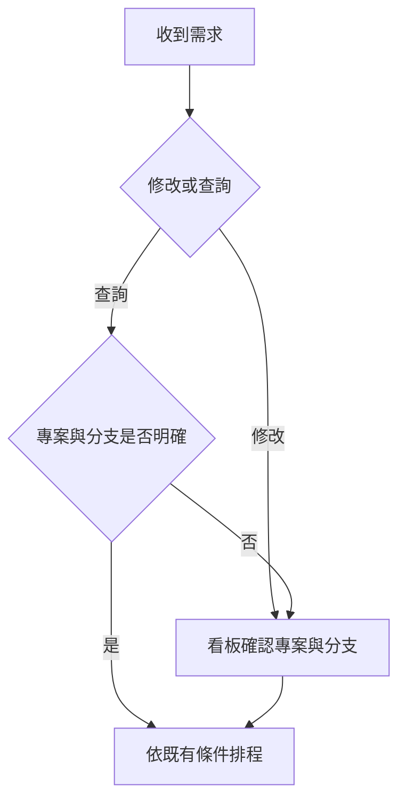

# 專案確認操作手順

修改程式先確認儲存庫與目標分支，查問題有依據才自動執行。聊天室綁定代表允許處理的範圍；環境驗證通過代表可以執行，都不代表 AI 選對本次需求的專案或分支。

## 修改程式

1. 在 LINE 以 `/任務` 提出需求，例如「修改報工畫面的機台欄位」。
2. 收到待確認通知後，點連結進入看板任務詳情。
3. 先看「處理專案」的聊天室、專案名稱、完整 `owner/repository` 與目標分支，再核對選擇理由、原始需求與驗收條件。
4. 正確就按「確認專案與分支並核准修改」。有建議方案時，先選方案，再按「確認專案與分支並採用方案」。
5. 不正確就按「更換專案」，選擇群組已綁定的正確專案、按「指定專案」，重新檢視後再確認。只有確定是長期規則才勾「記住」。
6. 等待執行完成，檢查 PR 後再人工合併。確認不會略過全域暫停、預算、風險、環境驗證或群組權限。

寫入專案 `AGENTS.md` 的聊天要求也屬於修改任務，需要確認。

## 查問題

1. 在 LINE 提問，例如「`/任務 請查 MachineSync 兩個機台欄位的用途`」。寫清楚專案名稱可減少歧義。
2. 本次明確指定唯一可用專案，或有唯一相關的實際檔案證據，且沒有其他疑點時，自動查詢。唯一的儲存庫名稱（例如 `OrderService`）也算指名。問題涉及權限、部署等敏感功能的運作方式不會被擋，只有要求交出機密實際值時才等人工確認。
   - 明確指名多個已綁定本群組的專案時，以第一個（或 AI 選的主要專案）為主，其他專案的原始碼唯讀一併提供；只要有一個指名的專案未綁定，就退回人工確認。
3. 沒有證據、候選不唯一、指名未綁定專案、分支不明確或與綁定衝突時，收到待確認通知。到看板選擇專案與分支，再按「確認專案與分支並開始查詢」。
4. 回答開頭會標示查詢專案、儲存庫、目標分支與實際讀取的 commit，先核對來源再閱讀結果。找不到資料時應明確說明缺少證據，不把其他專案或分支的行為當成答案。

## 同一個專案有不同分支

每筆任務各自保存目標分支。專案的基底分支只提供預設值；不必為了個別需求來回修改專案設定。同一專案的兩筆任務可分別使用 `develop` 與 `release/2026`，仍依原本執行名額與預算排程。

1. 在 LINE 指名儲存庫與完整分支，例如「`/任務 請修改 MachineSync 的 release/2026 分支，調整機台欄位提示`」。
2. 開啟看板，核對「目標分支」。需要調整時按「更換分支」。
3. 從 GitHub 分支清單選擇，或輸入完整名稱。畫面會分別標示專案預設與 GitHub 預設；分支太多時清單顯示前 500 筆，仍可輸入完整名稱驗證。
4. 按「儲存目標分支」。只改這筆任務，舊核准、舊來源 commit 與舊工作分支立即失效。
5. 重新檢視需求、儲存庫與分支，再按確認按鈕。執行中的任務不能直接換分支，必須先取消並等資源清理，再提出新任務。

查詢在明確指定唯一可用專案與實際分支、引用本次需求且其他條件通過時可自動執行。只說「主線」、涉及多個分支、分支不存在、引用不足，或拿預設分支的功能證據推測其他分支時，先由人確認。沒有指定分支且沒有疑點時，固定使用建立任務時的專案預設分支，不會根據本機目前分支或其他任務自動切換。

執行會先確認分支仍存在，固定該次來源 commit；修改從該 commit 建立獨立工作分支，PR 指向任務的目標分支。分支在執行前或發布檢查時消失，會交回待確認，不改查 `main`、標籤或其他分支。同分支在執行期間有新提交時仍沿用本次固定 commit；遇到 PR 衝突交由原有檢查處理。環境沿用專案設定，每次執行仍會安裝依賴並跑修改任務所需的測試與審查。

## 發現聊天室綁錯專案

1. 暫停該群組接收需求，檢查並取消已經在錯誤專案執行的任務。
2. 到「群組 → 可修改的專案」，移除錯誤專案並加入正確專案；沒有群組設定權限時由管理者處理。
3. 系統將該群組未完成的相關工作退回待確認，已移除的目標清空；不會自動搬到新專案。
4. 檢查群組記憶，刪除或修正指向錯誤專案的規則。
5. 逐筆重新指定並確認。若顯示先前執行尚未完成清理，等工作停止後再操作。
6. 恢復接收需求，以明確指名正確專案的查詢驗收。
7. 已產生的錯誤回答與 PR 由人檢查、註記或關閉；系統保留歷史，不自動回滾程式或重送舊訊息。

## 什麼時候需要重新確認

- 更換專案或目標分支、補充需求、切換查詢／修改類型，會產生新版本並作廢舊核准。
- 群組增加或移除綁定、目標專案設定改變，會作廢舊確認。執行中的舊工作會停止，不能發布舊結果。
- 舊頁面按核准會要求重新檢視，舊 LINE 採用按鈕只引導到看板。
- 重試只沿用同一需求、目標分支、專案設定及綁定版本的有效確認，不能代替確認。
- 升級前尚未執行、缺少新確認紀錄的任務會退回待審核；已完成的歷史回答與 PR 保留。

## 實作界線

AI 回傳選擇理由與本次輸入的證據引用，後端核對引用歸屬、內容、綁定及版本。證據存在不保證 AI 的語意判斷永遠正確，因此查詢結果固定標示專案；修改任務仍一律由看板成員確認。

人工確認記錄需求版本、目標專案、目標分支、專案設定版本、群組綁定版本、確認者與時間。原文只用於當次證據核對，長期保存引用位置，來源內容沿用原有撤回及到期規則。完成於分支功能上線前的歷史任務若沒有分支記錄，畫面會明確標示未記錄，不用目前專案設定猜測當時分支。
