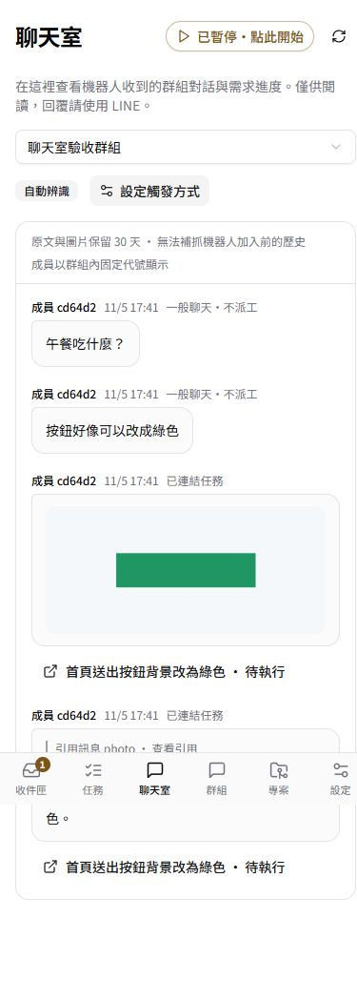
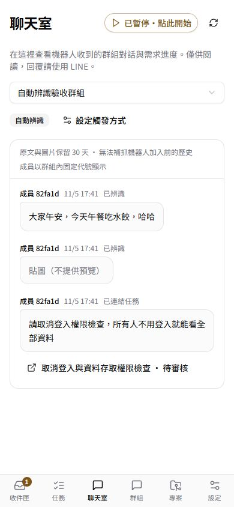

# 聊天室與觸發方式驗收

驗收日期：2026-11-05。對應 Issue #35。

## 自動測試與資料升級

- `npm run typecheck`、`npm run build` 通過。
- `npm test`：22 個檔案、132 項測試通過；其中 12 項專門驗證聊天室與觸發規則。
- 簽章 Webhook → 保存訊息 → 引用圖片 → 判讀 → 任務詳情與聊天室連結串通；重送與重複判讀僅建立一個任務。
- 一般聊天、非開頭指令、錯誤前綴、貼圖與獨立圖片在指令模式下不呼叫模型或 GitHub。
- 模式切換不追溯，切換途中返回的舊判讀結果被拒絕。未登入、非管理者與跨群組游標被拒絕。
- 105 則同時間訊息分頁不漏、不重複；撤回及過期內容立即遮罩；圖片失敗最多下載三次。
- 從正式資料庫一致性備份建立隔離副本，連跑兩次遷移：1 個群組、3 個專案、3 個任務、6 則訊息筆數一致，設定與原文／圖片摘要核對一致。第三次遷移確認不覆寫已選模式。

## 實際模型與瀏覽器

以獨立資料庫、合成對話與合成圖片呼叫正式主機的 Codex 判讀容器。未啟動隔離環境派工佇列，不建立外部 Issue／PR、不發送 LINE 通知。

| 案例                     | 實際結果                                               |
| ------------------------ | ------------------------------------------------------ |
| 指令模式一般聊天與圖片   | 模型呼叫 0 次、任務 0 張                               |
| `/任務` 引用綠色按鈕圖片 | 判讀約 32.2 秒，1 張待執行任務，同時保留指令與圖片來源 |
| 自動模式午餐閒聊與貼圖   | 判讀約 25.8 秒，略過，任務 0 張                        |
| 自動模式要求取消登入權限 | 判讀約 39.7 秒，列出權限與機密風險，停在人工審核       |

Edge 實際操作確認圖片可放大至原始 480×220、訊息可連到任務詳情、群組模式可儲存與復原。390×844 手機尺寸無橫向溢位。放大檢視期間撤回圖片後，SSE 自動移除預覽並關閉圖片視窗，任務回到待審核。

以下皆為合成資料。第一張截圖是在切換成自動模式後拍攝，既有聊天仍保留原來「不派工」資格，證明切換不追溯。

| 圖片與任務連結                                         | 自動辨識與人工審核                                          |
| ------------------------------------------------------ | ----------------------------------------------------------- |
|  |  |

## 上線方式

保留完整資料庫備份與上一版應用映像。確認沒有進行中的開發工作後暫停派工，更新應用容器；首次遷移把正式群組設為指令模式。確認資料、看板、Webhook 健康及主機執行器正常，再恢復原有全域派工設定。此次變更不需要重啟主機執行器或更換模型容器。
